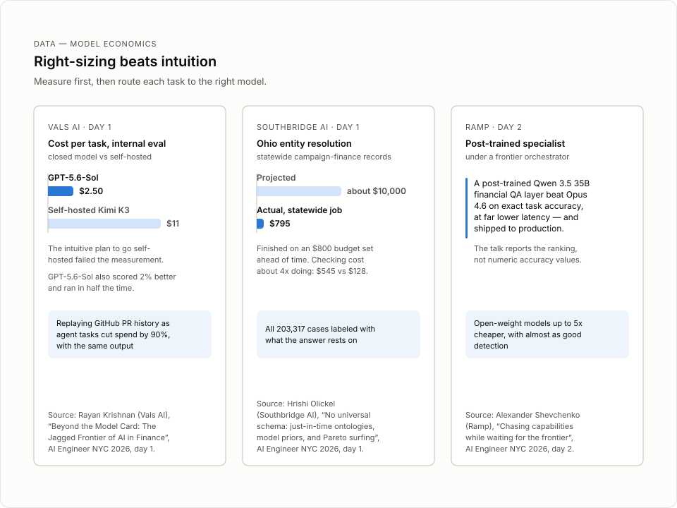

# Chasing capabilities while waiting for the frontier

> Ramp Labs' Alexander Shevchenko argues that an application-layer company should not wait for the next frontier model, and shows three Ramp cases where applied research closed the gap: a post-trained Qwen 3.5 specialist, KV-cache cartridges, and 10,000-agent pen-test swarms.

## TL;DR
- Ramp is "an extremely bitter lesson-built company": LLM use cases grew 123% in a year, while new frontier models made top features cheaper per unit even as token spend grew.
- The core question of the talk: "why not just wait?" for the frontier. Ramp's answer in 2023 and in 2026 is the same: ship now, and dig one layer deeper than the model.
- Ramp Labs post-trained a Qwen 3.5 35B model with Prime Intellect as a financial question-answering layer under frontier orchestrators. It beat Opus 4.6 on exact task accuracy at far lower latency, and it shipped to production.
- KV-cache cartridges compress 20 to 30 times more context offline, so a month-end close agent starts with the ledger and aging report already understood.
- Ramp ran 10,000 parallel agents to pen test the whole company, found seven high-severity vulnerabilities, and patched all of them. One was a Lua script injection delivered over email that no single unsafe component explained.
- The research feeds two Ramp products: token spend management and Ramp Router.

## Key lessons
1. Treat frontier progress as a tailwind, not a plan. Ramp shipped agents like "Grantor Guide" (as transcribed) on GPT-4-class models in 2023 despite strict guardrails, no thinking tokens, and prompts so brittle that synonyms changed behavior. In 2026 models handle MCPs and open context well, but "we can dig a layer down and create even better experiences" — it just takes more effort.
2. Post-train a specialist beneath the orchestrator. The friction in Ramp Sheets (launched November, before the two frontier labs shipped spreadsheet agents) was slow, expensive planning over many dropped-in spreadsheets on Opus 4.6. Ramp partnered with Prime Intellect to post-train a Qwen 3.5 35B retrieval / financial question-answering model that kept frontier models as orchestrators, scored above Opus 4.6 on exact task accuracy, and served at "high KU level latencies" (as transcribed; queue-level). This went to production.
3. Use KV-cache cartridges for predictable work. Cartridges compress up to 20 to 30 times more context into the KV cache offline. Ramp can build one overnight before the first of the month, so the finance professional's agent "knows exactly what it needs to do" for month-end close without agentic retrieval at run time. Cartridges are lower lift than post-training, but the labs may ship the technique as an API feature; Ramp is fine with that because the tribal knowledge still pays off on day one.
4. Scale verification with agentic map reduce. Ramp's cloud agent Ramp Inspect spun up 10,000 parallel agents to pen test all of Ramp, then used LLMs to deduplicate and adversarially reproduce the tickets. The run found seven high-severity vulnerabilities, all patched, including a Lua script injection sent over email that required chaining an understanding of multiple components end to end — no single component was unsafe.
5. Buy detection rate with cheap tokens. In the swarm setup, open-weight models up to five times cheaper than frontier reasoning models did not give a five-times-lower detection rate. Spending more on cheaper tokens keeps detection almost as good at a fraction of the cost. The whole pipeline runs unattended; the only cost is the tokens for failed passes that get filtered out.
6. Amortize post-training with transfer. The Ramp Labs "Portal" technique moves learnings from one post-train to another: train a LoRA latent on one model, then project it onto newer Qwen versions or across model families. This cuts the cost of repeating post-training work.
7. Route research into products. The same themes — saving time (latency) and money (token cost), which is Ramp's slogan — show up in two shipped products: token spend management (API-key, user, accounting-category, and tax-credit views plus a semantic taxonomy of LLM usage) and Ramp Router (routing strategies such as "Nvidia Switchyard" and Smart Flex offloading, as transcribed).

## Figures



Right-sizing economics: the 35B specialist panel is from this talk.

## Notable quotes
> "And to caveat my presentation on Ramp Labs, Ramp is an extremely bitter lesson-built company." [00:20:55 | 9:01:30 AM]

> "And so, given all this, a question that I sometimes get: why not just wait?" [00:21:34 | 9:02:09 AM]

> "At the end of all of this, we have actually found seven high severity vulnerabilities that we all patched." [00:29:04 | 9:09:40 AM]

> "One of the interesting insights from that same article that we published is that you can actually use open-weight models that are up to five times cheaper compared to the frontier reasoning." [00:30:00 | 9:10:36 AM]

## Session narrative
MC Ksenia Se opened the first keynote slot of day three at 9:00:35 AM ET, framing Ramp as a company working "at the intersection of those two worlds" and welcoming "Alexander Shevchenko with Chasing Capabilities While Waiting for the Frontier" [00:20:08]. Alex introduced himself as three years at Ramp on the broader applied AI team, applying LLMs and ML across surfaces and products. He set the talk's premise with the Bitter Lesson: over the last year the number of Ramp use cases using LLMs grew 123%, while unit economics improved because each new frontier model is "cheaper, faster, and better." That raised the question he often gets — why keep an applied research function at an application-layer company instead of waiting for the frontier — and he answered it by recalling 2023, when Ramp shipped agents on GPT-4-class models with brittle prompts, no backtracking, and tightly scoped context, rather than wait for GPT-4.5 or GPT-5.

The core of the talk was three Ramp Labs cases sent toward production. First, a specialist model: Ramp Sheets, one of the early spreadsheet agents launched in November before the two frontier labs shipped theirs, hit friction when Opus 4.6 spent slow, expensive thinking tokens planning over many dropped-in spreadsheets. Ramp partnered with Prime Intellect to post-train a Qwen 3.5 35B financial question-answering model that kept frontier models as orchestrators, beat Opus 4.6 on exact task accuracy, and served at low latency. Second, KV-cache cartridges, which compress 20 to 30 times more context offline; Ramp can build a cartridge overnight before month-end close so the agent starts with the ledger, aging report, and documents already understood. He noted the caveat that labs may ship this in their APIs, and said Ramp would be happy because the internal know-how transfers on day one. Third, agentic map reduce: Ramp Inspect orchestrated 10,000 parallel agents to pen test all of Ramp, LLMs deduplicated and adversarially reproduced the findings, and the run surfaced seven high-severity vulnerabilities — all patched — including a Lua script injection over email that only a cross-component view could catch. He added the cost insight that open-weight models up to five times cheaper than frontier reasoning keep almost the same detection rate in a swarm.

He closed by naming the pattern across all three cases: saving time and money, which is literally Ramp's slogan. Two Ramp products carry the research into the market — token spend management, which connects API keys and semantically classifies LLM usage down to accounting categories and tax credits, and Ramp Router, which applies routing strategies such as "Nvidia Switchyard" and Smart Flex offloading to improve latency and cost per token. He paused on a QR-code slide for the product URLs, then pointed to the Ramp Labs blog for work not covered on stage: Portal (transferring post-train learnings across model versions and families), more agentic map reduce (taxonomies of LLM usage that feed the token spend product), self-improving monitoring that writes and improves Datadog monitors without a person in the loop, and semantic tagging that clusters user sessions into open-ended taxonomies. He shared x.com/ramplabs and his personal Twitter for follow-up, and ended at 9:15:01 AM ET with "And that's it. Thank you." — ahead of the 9:18am agenda slot end, after which the stream cut to the next speaker introduction.

## Speaker details
**Alexander Shevchenko** - Head of Ramp Labs and Applied Research, Ramp. Alexander (Alex) Shevchenko leads Ramp's applied AI lab, Ramp Labs, in New York; his projects there include Ramp Sheets, early computer-use agent work, vendor deep research, and video process mining. Before Ramp he was a software engineer at Microsoft working on process mining (Power Automate Process Mining), and he studied at Concordia University. In this session he said he joined Ramp around three years ago on the broader applied AI team. Links: [LinkedIn](https://www.linkedin.com/in/shevalex), [Website](https://ramp.com/)

**Ksenia Se** - Co-founder and "AI Inferencer", Turing Post. Ksenia Se co-founded Turing Post, a newsletter and media platform covering machine learning and AI, where she leads the "Inference" interview series and produces the "Attention Span" video series; she has covered AI for more than seven years and is a frequent speaker and moderator at conferences such as AIE, HumanX, and Ai4. She was the MC for day three of AI Engineer NYC and appears in this session for the hand-off only [00:20:00-00:20:15]. Links: [LinkedIn](https://www.linkedin.com/in/ksenia-se), [Twitter](https://x.com/Kseniase_), [Website](https://www.turingpost.com)

## Full timestamped transcript
```
[00:20:00 | 9:00:35 AM] And our first speakers work at the intersection of those two worlds at Ramp.
[00:20:08 | 9:00:43 AM] So please help me welcome Alexander Shevchenko with Chasing Capabilities While Waiting for the Frontier.
[00:20:15 | 9:00:50 AM] Thank you.
[00:20:16 | 9:00:51 AM] Hey everyone, I'm Alex from Ramp.
[00:20:26 | 9:01:01 AM] I'll be speaking about chasing capabilities while waiting for the frontier to advance.
[00:20:39 | 9:01:14 AM] So, quick intro about myself.
[00:20:41 | 9:01:16 AM] I joined Ramp around three years ago on the broader applied AI team, working on a bunch of different surfaces and products, applying LLMs and ML to make a great product even better.
[00:20:55 | 9:01:30 AM] And to caveat my presentation on Ramp Labs, Ramp is an extremely bitter lesson-built company.
[00:21:02 | 9:01:37 AM] Over the last year, the number of use cases that use LLMs has increased 123%, while at the same time, a lot of our top features are growing in token spend, but on a unit economic basis, they're actually becoming cheaper because there are frontier models that are being released all the time now, and these models are cheaper, faster, and better.
[00:21:25 | 9:02:00 AM] And so we're able to provide the same level of accuracy at a much lower cost.
[00:21:29 | 9:02:05 AM] And so this is a really bitter lesson-built pattern.
[00:21:34 | 9:02:09 AM] And so, given all this, a question that I sometimes get: why not just wait?
[00:21:40 | 9:02:16 AM] Why have an applied research function inside of a company like Ramp, an application-layer company, right?
[00:21:48 | 9:02:23 AM] And to answer that, I would like to draw a parallel to 2023.
[00:21:53 | 9:02:29 AM] Back in 2023, you had access to kind of like GPT-4, and creating an agent was a lot of work.
[00:22:01 | 9:02:37 AM] You would have to create very, very strict guardrails.
[00:22:05 | 9:02:41 AM] Models weren't RL'd to backtrack.
[00:22:07 | 9:02:43 AM] They didn't have thinking tokens, and so if it went in the wrong direction, it would just kind of charge ahead and not realize that it made mistakes.
[00:22:16 | 9:02:51 AM] You had to sweat over all of the prompts to the point where some synonyms could change the behavior of your agent because they weren't RL'd properly on generalizing to the user's intent.
[00:22:31 | 9:03:06 AM] You had to reduce and scope down the context as much as possible because giving too much context to the agent would just confuse it.
[00:22:40 | 9:03:15 AM] And even back then, we decided, well, we need to ship these things.
[00:22:44 | 9:03:19 AM] We can't wait for GPT-4.
[00:22:46 | 9:03:21 AM] 5 or GPT-5 to come out.
[00:22:48 | 9:03:23 AM] We need to serve our financial professionals now.
[00:22:51 | 9:03:26 AM] And we shipped things like Grantor Guide and many other agents, even though it was not the easy thing to do.
[00:22:58 | 9:03:33 AM] And fast forward now to 2026, building an agent is a lot easier.
[00:23:02 | 9:03:37 AM] The models have gotten so much better that you can kind of give them MCPs and access to kind of any context, and they do a very, very good job of understanding what they need to do given a task.
[00:23:13 | 9:03:48 AM] But I still believe that we can dig a layer down and create even better experiences for our users.
[00:23:21 | 9:03:57 AM] It just requires a bit more effort now.
[00:23:25 | 9:04:00 AM] So to present this, some of our work from Ramp Labs, three specific cases of how we've applied research into Ramp itself, starting with creating a specialist model.
[00:23:39 | 9:04:14 AM] So in November of last year, we launched Ramp Sheets, which was one of the really early spreadsheet agents.
[00:23:47 | 9:04:22 AM] This was before the two frontier labs had launched their versions of spreadsheet agents, and we had a very good launch in November.
[00:23:53 | 9:04:29 AM] A bunch of users from great companies had signed up and started using it, and we realized that, well, this is a very general purpose spreadsheet handling agent, and a lot of the work that people do on Ramp, both inside of the company, but also all of our customers, accounting and finance professionals, are spending most of their days inside of spreadsheets.
[00:24:16 | 9:04:52 AM] So we can kind of take the harness and the brains behind Ramp Sheets and add it into a bunch of other surfaces within Ramp.
[00:24:27 | 9:05:02 AM] And as we were building this out, we realized, well, we can probably apply some research from Ramp Labs to make this even better.
[00:24:36 | 9:05:12 AM] And we sat down and we started looking, where do models fall short on this?
[00:24:41 | 9:05:17 AM] And back then this was like Opus 4.
[00:24:44 | 9:05:19 AM] 6, and the place that had the most friction was when you would drop in a lot of spreadsheets into Ramp Sheets and you would ask it to build a DCF or model some financial scenario, it would spend a lot of time creating a plan at first and then researching all of the sheets that it had access to to try to get a good understanding of the lay of the land.
[00:25:06 | 9:05:41 AM] And Opus 4.
[00:25:07 | 9:05:42 AM] 6 is a great model, but it was like pretty slow and the thinking tokens are also pretty expensive.
[00:25:13 | 9:05:48 AM] And so we took a step back and decided to train a retrieval model, or kind of like a financial question answering model that would, while still keeping these frontier models as orchestrators, would then be handed off to this much faster model that would do financial question answering for that planning agent.
[00:25:34 | 9:06:10 AM] And so we partnered with the company Prime Intellect to post-train a Qwen 3.
[00:25:40 | 9:06:16 AM] 5 35 billion model, and we actually got above Opus 4.
[00:25:47 | 9:06:22 AM] 6, which was the frontier back then, exact task accuracy while also being able to serve it at high KU level latencies.
[00:25:56 | 9:06:31 AM] So a much faster, but just a smart model that could then be used in tandem with the really smart frontier orchestrator.
[00:26:07 | 9:06:42 AM] And so this was like a very successful example of post-training that we had actually sent to prod as part of our Ramp Labs effort.
[00:26:16 | 9:06:52 AM] The second big thing that we are actually exploring up to this day is KV cache tricks, and particularly cartridges are a really interesting family of techniques where you're able to compress a lot of context, up to 20 to 30 times more context, into the KV cache offline and serve it for your agent.
[00:26:40 | 9:07:15 AM] And so if you compare it to the Ramp Sheets example, for example, there's a lot of tasks that you know are going to happen at some point, right?
[00:26:49 | 9:07:25 AM] Like month-end close, a month finishes, and on the first of the next month, a financial professional will go and try to reconcile and close their books.
[00:26:57 | 9:07:33 AM] You know kind of the ledger, the aging report, and the documents that they will need to be retrieving.
[00:27:02 | 9:07:38 AM] And so you could prepare them as context, but the agent will still need to agentically retrieve and create a good picture and understanding of them.
[00:27:11 | 9:07:47 AM] With cartridges, we're able to compress all of that work and build one overnight before the financial professional starts their work on the first of the month, and Once they open up the agent, it knows exactly what it needs to do because it has all of the context already built in.
[00:27:30 | 9:08:06 AM] Cartridges are also a much lower lift than post-training because the way that they do self-play is kind of a lot more generalizable.
[00:27:38 | 9:08:14 AM] The caveat with stuff like this is that compared to post-training, this is something that the labs might ship at some point in their APIs, in their foray into continuous learning.
[00:27:50 | 9:08:25 AM] And even if they were to do it in the API, we would actually be happy because we are developing a lot of this tribal knowledge inside of the company and just learning how best to apply these techniques.
[00:28:00 | 9:08:36 AM] So even if it does ship as an API, we can just hit the ground running on day one knowing how to use them.
[00:28:09 | 9:08:44 AM] And finally, the third example of applied research that we are sending to prod is our work on agentic map reduce and kind of agentic swarms.
[00:28:21 | 9:08:56 AM] So more concretely, we published an article on the Ramp Labs blog on how we used 10,000 parallel agents to pen test all of Ramp.
[00:28:32 | 9:09:08 AM] So at Ramp, we have a cloud agent called Ramp Inspect, which helps out with setting up all of the infrastructure and plumbing for something as ambitious as this.
[00:28:42 | 9:09:17 AM] And we were able to spin up 10,000 parallel agents and then kind of map this work out, try to find any vulnerabilities, and then also agentically reduce on the tickets that they would create.
[00:28:55 | 9:09:31 AM] So deduplicate them with LLMs and then try to reproduce them adversarially with LLMs to try to make sure that the vulnerabilities are real and important.
[00:29:04 | 9:09:40 AM] At the end of all of this, we have actually found seven high severity vulnerabilities that we all patched.
[00:29:11 | 9:09:46 AM] Interestingly, one of the Vulnerabilities that we described in that article is a Lua script injection that you could send over via email.
[00:29:19 | 9:09:55 AM] And no single component of that stack was unsafe, and the kind of swarm had to patch together multiple components and understanding of multiple components end to end in order to be able to figure this out.
[00:29:34 | 9:10:09 AM] And the other nice thing with this is that this is all running automatically.
[00:29:38 | 9:10:14 AM] You don't need to spend anyone's time.
[00:29:40 | 9:10:15 AM] It's just you start it, and the only thing that failed passes that get filtered out is the cost of the tokens.
[00:29:48 | 9:10:24 AM] The other thing that's interesting outside of just building out all of the infrastructure to support these swarms is that we do research into how to best use models as part.
[00:29:59 | 9:10:34 AM] Models as part of these swarms.
[00:30:00 | 9:10:36 AM] One of the interesting insights from that same article that we published is that you can actually use open-weight models that are up to five times cheaper compared to the frontier reasoning.
[00:30:11 | 9:10:47 AM] And because you're setting it up as a swarm, the detection rate is not five times lower.
[00:30:17 | 9:10:52 AM] So you can kind of spend more on these cheaper tokens and have almost as good of a detection rate.
[00:30:23 | 9:10:58 AM] If you follow through all of these examples, you kind of notice a pattern of a lot of them is attempts at saving on time and saving on money.
[00:30:38 | 9:11:13 AM] So reducing latency, which is time, and then reducing on token cost, which is money.
[00:30:42 | 9:11:18 AM] That's actually Ramp's slogan: saving our customers time and money.
[00:30:47 | 9:11:23 AM] And so I'd like to point to two products that we actually offer from Ramp that have been influenced by Ramp Labs' research.
[00:30:55 | 9:11:31 AM] The first one is token spend management that connects to a bunch of your API keys and is able to give you a really good picture of how LLMs are being used inside of your company.
[00:31:06 | 9:11:41 AM] Not only token spend on an API key basis or a user basis, but digging deeper, accounting categories, and even things like tax credits that you can get by analyzing the spend.
[00:31:22 | 9:11:58 AM] It also goes deeper, and we created a taxonomy that contextually analyzes and semantically analyzes the LLM usage so you can actually understand how LLMs are being used outside of just attributing it to a team or a person inside of your company.
[00:31:37 | 9:12:13 AM] And then the second one is Ramp Router, which also leans into improving the latency of your agent, where we have a bunch of routing strategies that we work with Ramp Labs to develop, things like Nvidia Switchyard, things like Smart Flex offloading of work to both improve latency and cost per tokens that you spend.
[00:31:59 | 9:12:34 AM] And there's a bunch of different strategies already available for routing, and even more coming out later.
[00:32:06 | 9:12:42 AM] So if you're interested in any of these two products, you can take a photo of the URLs or scan the QR codes there.
[00:32:13 | 9:12:49 AM] Give you a second.
[00:32:20 | 9:12:56 AM] Awesome.
[00:32:22 | 9:12:58 AM] And then I'd also invite you to check out our Ramp Labs blog, where we publish a bunch of really interesting articles that I haven't had the chance to cover as part of this presentation.
[00:32:35 | 9:13:10 AM] Notably, one of the really interesting ones is Portal, where we figured out a way of transferring learnings from one post-train to another.
[00:32:43 | 9:13:19 AM] So you could do something like a LoRA post-train on one model, so like the Qwen 3.
[00:32:50 | 9:13:25 AM] 5 that I was describing, but then transfer it to newer versions of Qwen or even across different families.
[00:32:56 | 9:13:31 AM] So you're post-training this latent that then can be projected onto different models, and that really amortizes the cost that you have to spend on post-training.
[00:33:06 | 9:13:41 AM] More blog posts on agentic map reduce, so not only the pen testing stuff that we did, but also things like analyzing and creating taxonomies of LLM usage, which is stuff that has gone into the token spend product.
[00:33:20 | 9:13:55 AM] Things like self-improving monitoring, where we use LLMs to automatically create monitors with Datadog on a lot of our product surfaces, and then as alerts come in, improve those monitors automatically without a person in the loop to try to basically create super, super robust and resilient software.
[00:33:41 | 9:14:16 AM] And finally, semantic tagging, which is this interesting foray into creating this agentic map reduce over a bunch of user sessions, where we can annotate and create taxonomies that are open-ended.
[00:33:53 | 9:14:29 AM] So not knowing ahead of time what are the clusters of LLM usage and trying to create a taxonomy that can then be reconciled against the spend inside of the companies.
[00:34:05 | 9:14:41 AM] So if you're interested in this type of research, x.
[00:34:09 | 9:14:44 AM] com/ramplabs, where you can go and check out more of our research.
[00:34:15 | 9:14:51 AM] And here's my Twitter if you have any other questions or want to talk about some use case as part of your applied research.
[00:34:25 | 9:15:01 AM] And that's it.
[00:34:26 | 9:15:01 AM] Thank you.
```
