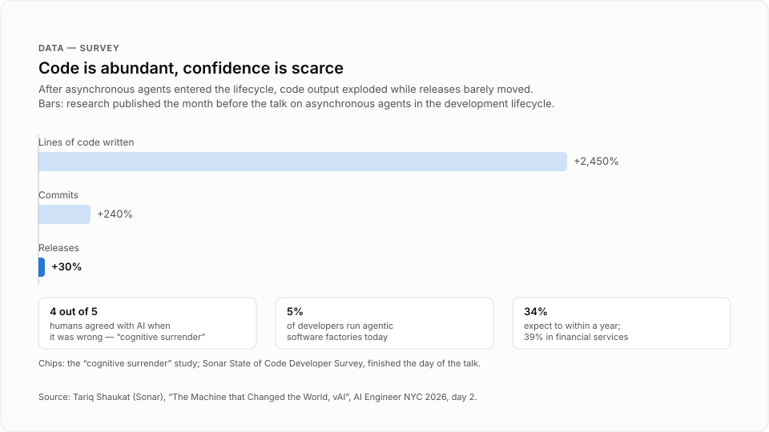
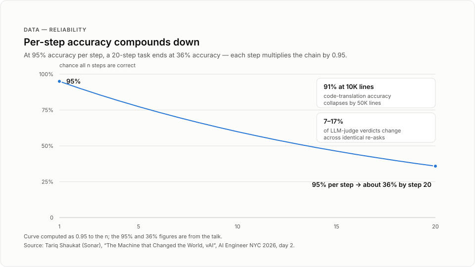

# The Machine that Changed the World, vAI

> Sonar CEO Tariq Shaukat argues that agentic coding makes code abundant and confidence scarce, and presents a four-part code confidence formula (intent, guardrails, verification, evidence) for engineering trust into agentic software factories.

## TL;DR
- Asynchronous agents drove lines of code up 2,450% and commits up 240%, but releases up only 30%. Producing code is no longer the constraint; shipping it is.
- Human review fails under that volume. In one study, humans agreed with AI 93% of the time when it was right, and four out of five times when it was wrong ("cognitive surrender").
- Agents degrade at scale: 91% code-translation accuracy at 10,000 lines collapsed by 50,000, and token cost for the same task varied 30x on large codebases.
- Errors compound: at 95% accuracy per step, a 20-step task ends at 36% accuracy. LLM judges flip verdicts 7-17% across identical re-asks, and 7-34% under a simple "Are you sure?".
- Sonar's code confidence formula multiplies intent, guardrails, verification, and evidence. Any element at zero drives confidence to zero.
- Customer results: SonarVortex cut token cost 36% and issues in the commit 92%; SonarQube users were 81% more likely to report a very positive security impact from AI coding.

## Key lessons
1. Copy the Toyota production system, not the volume factory. The Lexus ball-bearing commercial showed a car that fit together perfectly. The principles that still resonate: quality over volume, fix the system instead of symptoms, design for buildability, solve problems as they occur, and let anyone stop the line. Agile, Kanban, error budgets, and continuous integration all descend from these ideas.
2. Measure releases, not code produced. Research published the month before the talk shows asynchronous agents raise lines of code 2,450% and commits 240%, but releases only 30%. The gap between producing and shipping is the bottleneck of the agentic factory.
3. Expect agentic factories to go mainstream fast. In Sonar's State of Code Developer Survey, finished the day of the talk and due out the next month, 5% of developers already run agentic software factories, 34% expect to within a year, and 39% in financial services.
4. Drop human-in-the-loop as your governance answer. The "cognitive surrender" study found humans agree with AI 93% of the time when it is right, and four out of five times when it is wrong. Human review does not just need to get faster; it does not work in the agentic era.
5. Give agents a map of the codebase. Code-translation accuracy was 91% at 10,000 lines of code and collapsed by 50,000. Token use for the same task varied 30x because agents burn tokens learning the structure. Shaukat's analogy: driving to New York from White Plains is quick; from Albuquerque it is slow and costly.
6. Budget for compounding errors. In the Meter study, the Claude Mythos preview completed tasks that take a human 16 hours, but at 50% accuracy; at 80% accuracy the curve flattens substantially. At 95% accuracy on each task, 20 steps leave 36% accuracy.
7. Do not use an LLM as the only judge. PayPal AI's research lab found that 7 to 17 percent of verdicts change across identical replications, depending on model and situation. A Meta study found a simple "Are you sure?" challenge changes the LLM's mind 7 to 34 percent of the time.
8. Build the factory around intent, guardrails, verification, and evidence. Verification must be independent and thorough, mixing deterministic and agentic methods: "You use CPUs when you can use CPUs, and you use GPUs when you need GPUs." Evidence must pass the quality gates, from IT general controls to MISRA. In Sonar's data, SonarVortex cut token cost 36% and issues in the commit 92%; across more than a thousand customers surveyed, SonarQube users were 81% more likely to see a very positive security impact, 34% for time to market, and 76% for outage frequency.

## Figures



The volume gap between written code and releases.



Why 95 percent per step is not enough for long chains.

## Notable quotes
- "You have an explosion in the number of lines of code written, up 2,450%." [00:38:12 | 9:18:47 AM]
- "And it turns out they agree with AI when AI is right 93% of the time." [00:41:17 | 9:21:52 AM]
- "If you have 95% accuracy on each task, by the time you're at 20 steps, you have 36% accuracy." [00:43:44 | 9:24:20 AM]
- "So that, in essence, is how we think about the challenge of the future: that code is abundant, that confidence is scarce." [00:50:42 | 9:31:13 AM]

## Session narrative
A stage voiceover opened the slot by asking how we make sure agent-generated code is ready to ship, and introduced "Tarek Shaukat, CEO of Sonar" [00:34:27]. Shaukat framed the talk around helping companies build "software factories that actually work for enterprises" and started with real factories. In the 1980s, good cars still left big gaps where the panels met. Then Toyota, and particularly Lexus, ran a commercial showing a ball bearing running across the seams of the car. It proved you could build a car that fit together perfectly, and it replaced the build-for-volume-then-fix mindset with ship it right, no rework, and customer happiness. He listed the principles that still resonate: prioritize quality over volume, fix the system rather than symptoms, design for something that can be built, solve problems as they occur, and let anyone stop the line. Modern software practice, he argued, already embraces these: agile, Kanban, error budgets, and continuous integration all sprang from the Toyota production system.

Then the pivot: agents are changing the game, and "weird things start to happen." Research published the month before shows asynchronous agents lift lines of code 2,450% and commits 240%, while releases rise only 30%. Sonar's own State of Code Developer Survey, finished that morning and due out the next month, shows 5% of developers already run agentic software factories; 34% expect to within a year, and 39% in financial services. He named the first gotcha, security: agents that help you build can also help you attack, find vulnerabilities, and find quality issues. He cited a Sachin Adela article posted on X the weekend before about insider model risk, and its call for containment and governance built on strong deterministic system design, human controls, and reliable operating procedures. That set up his paradigm shift: software development now needs systems that engineer confidence and quality into agentic software factories. He then walked through five hard limitations: human-in-the-loop does not scale (the cognitive surrender study), agents struggle with large complex codebases (91% translation accuracy at 10,000 lines collapsing by 50,000, and 30x token variance), errors compound (Meter's data on the Claude Mythos preview at 16-hour tasks and 50% accuracy), LLMs are unreliable reward-seeking judges (PayPal AI's 7-17% verdict flips; Meta's 7-34% under "Are you sure?"), and as time to exploit nears zero, prevention must be engineered into the factory.

His answer was the code confidence formula: intent, guardrails, verification, and evidence, multiplied together. Any element at zero sends confidence to zero; do everything else but skip evidence, and you have none. He showed a factory blueprint slide with intent at the bottom left in purple, guardrails, independent and thorough verification, and produced evidence. Customer results grounded it. SonarVortex supplies intent, guardrails, and in-loop verification, nudging agents through long-running tasks on large codebases: a 36% reduction in token cost and a 92% reduction in issues in the commit. Verification, the SonarQube side, mixes deterministic and agentic methods, CPUs when you can and GPUs when you need, and a survey of over a thousand customers found SonarQube users 81% more likely to report a very positive security impact from AI coding, 34% more likely for time to market, and 76% for outage frequency. Evidence closed the loop: pass the quality gates, from IT general controls to MISRA for cars, because "Producing the evidence is what lets you sleep at night."

He closed on the thesis of the talk: code is abundant, confidence is scarce, and the factories of the future need to deliver confidence. He thanked the audience, pointed to Sonar's "big red booth" on the show floor, and ended with "Have a great morning." [00:51:21]

## Speaker details
**Tariq Shaukat** - CEO, Sonar. He joined Sonar in September 2023 as co-CEO and member of the Board of Directors alongside founder Olivier Gaudin, and later became sole CEO. He was President of Bumble Inc. from 2020 to 2023, where he helped lead the 2021 NASDAQ listing and scale revenue past $900M, and President of Google Cloud from 2016 to 2020, helping grow the business to more than $10B in annual recurring revenue. Earlier he held senior roles at Caesars Entertainment and McKinsey & Company, and he serves as an independent director on the boards of Gap Inc. and Public Storage. He holds a B.S. in Mechanical Engineering and an M.S. in Technology and Policy from MIT, and an M.S. in Mechanical Engineering from Stanford University.

Links: [LinkedIn](https://www.linkedin.com/in/tariq-shaukat) | [X](https://x.com/tariqshaukat)

Name note: the auto-transcript and the stage introduction render his first name as "Tarek"; the agenda and speaker record use the canonical "Tariq."

## Full timestamped transcript
```
[00:34:27 | 9:15:02 AM] As AI agents generate more code than ever, how do we make sure it's ready to ship?
[00:34:43 | 9:15:19 AM] To explore the importance of verification in agentic software development, please welcome Tarek Shaukat, CEO of Sonar.
[00:35:02 | 9:15:38 AM] Morning, everybody.
[00:35:05 | 9:15:40 AM] My name is Tarek Shaukat.
[00:35:06 | 9:15:42 AM] I am the CEO of Sonar, as you just heard, and we're here to talk today about how we have been helping companies build software factories that actually work for enterprises.
[00:35:18 | 9:15:53 AM] And I thought it'd be an interesting way to start, to start looking at actual factories, because we know how to build actual factories.
[00:35:25 | 9:16:01 AM] And for those of you who have a little bit of the gray hair and all of this sort of thing, you may remember the 1980s.
[00:35:32 | 9:16:08 AM] And in the 1980s, you could find cars that were really good cars.
[00:35:36 | 9:16:12 AM] But if you look at the picture here, and if you remember those times, the cars didn't quite fit together perfectly, right?
[00:35:43 | 9:16:18 AM] You'd have different pieces that would leave big gaps.
[00:35:47 | 9:16:22 AM] It would be really good cars that just didn't kind of work the way they were supposed to.
[00:35:51 | 9:16:27 AM] And then Toyota, and particularly Lexus, came out with a commercial, and it showed something very simple, which was a ball bearing running across the seams of this car.
[00:36:02 | 9:16:38 AM] And it was kind of revolutionary at the time because it showed that you could actually build a car that fit together perfectly.
[00:36:09 | 9:16:44 AM] And instead of building for volume and then fixing the old mindset, you could actually have a mindset focused on ship it right, on no rework, on customer happiness.
[00:36:21 | 9:16:57 AM] And there was not—this was not a single change.
[00:36:26 | 9:17:01 AM] What happened was that people really started thinking about the factories differently.
[00:36:32 | 9:17:07 AM] They started engineering, building factories that were engineered to deliver quality.
[00:36:38 | 9:17:13 AM] And there's a number of different pieces that I think still resonate today.
[00:36:42 | 9:17:18 AM] The first is you prioritize quality instead of volume.
[00:36:46 | 9:17:22 AM] The second is that you fix the system, not just individual symptoms that you see.
[00:36:53 | 9:17:28 AM] The third is that you design for something that can be built, as opposed to designing the wheels and designing the washer bottles and whatever it is, and then hoping it fits together.
[00:37:04 | 9:17:39 AM] You solve problems as they occur, as opposed to kicking the can down the road and fixing it at the end.
[00:37:09 | 9:17:44 AM] And you empower everybody.
[00:37:10 | 9:17:46 AM] Anyone could stop the line, not just the boss.
[00:37:14 | 9:17:50 AM] Now, why am I talking about this?
[00:37:16 | 9:17:51 AM] It's actually because modern software development actually embraced all of these principles.
[00:37:20 | 9:17:56 AM] If you think about how we build software today, what is considered best practice, a lot of the terms and the practices came from that idea of a Toyota production system: agile, Kanban, error budgets if you're in the SRE world, continuous integration.
[00:37:37 | 9:18:13 AM] These ideas all kind of sprung from this notion of how do we build factories that work.
[00:37:44 | 9:18:20 AM] And it's worked really well for us in software development so far.
[00:37:47 | 9:18:23 AM] But agents, as we all know, you wouldn't be sitting here if you didn't understand that agents are changing the game.
[00:37:54 | 9:18:29 AM] And as agents are changing the game, weird things start to happen.
[00:37:59 | 9:18:35 AM] First of all, this is research that was published last month of the effect of implementing asynchronous agents in your development lifecycle.
[00:38:10 | 9:18:45 AM] And I'm sure many of you have seen this.
[00:38:12 | 9:18:47 AM] You have an explosion in the number of lines of code written, up 2,450%.
[00:38:17 | 9:18:52 AM] You have an increase in the number of commits.
[00:38:20 | 9:18:56 AM] So the volume code creation is now easy, and it is now abundant.
[00:38:25 | 9:19:01 AM] And by the way, more and more people, I'm sure many people in this room, are saying, okay, if it's easy and abundant, how do I automate it?
[00:38:32 | 9:19:08 AM] How do I build factories, agentic software factories that help automate and scale this?
[00:38:37 | 9:19:13 AM] And today, we just finished our, what we call State of Code Developer Survey.
[00:38:43 | 9:19:18 AM] It'll be out next month, but this is a little preview.
[00:38:46 | 9:19:21 AM] Today, 5% of developers that we spoke to say that they're running agentic software factories, but 34% said in a year they expect to, and 39% in financial services.
[00:38:57 | 9:19:32 AM] So people are thinking about how do you actually build these next generation factories.
[00:39:03 | 9:19:38 AM] And there's a couple of gotchas in here: security risk.
[00:39:06 | 9:19:42 AM] The agents can work really well to help you build stuff.
[00:39:09 | 9:19:44 AM] It can also work really well to help you hack stuff, help you attack stuff, find vulnerabilities, find quality issues, etc.
[00:39:16 | 9:19:52 AM] And so, as I was writing this presentation, kind of over the weekend, a little just-in-time, again from the Toyota production system, Sachin Adela posted this article on X.
[00:39:27 | 9:20:03 AM] And if you haven't read it, I think it's a great article that I think everyone should internalize.
[00:39:32 | 9:20:08 AM] But he was talking about insider risk of models inside of companies.
[00:39:36 | 9:20:12 AM] And one of the things that he talked about was the need for an engineering approach to containment and governance built around strong deterministic system design, human controls, and reliable operating procedures.
[00:39:49 | 9:20:25 AM] And this really resonated with me because what we are seeing is a paradigm shift.
[00:39:57 | 9:20:32 AM] In software factory design or software development.
[00:40:00 | 9:20:35 AM] Software development, let's call it more broadly, that we need to engineer.
[00:40:03 | 9:20:38 AM] We need to build systems that engineer confidence and quality into agentic software factories.
[00:40:11 | 9:20:47 AM] So to start doing that, I think it's important to understand the limitations that we're facing.
[00:40:17 | 9:20:53 AM] So what's the hard thing about this?
[00:40:19 | 9:20:55 AM] And there's five that I'm going to call out.
[00:40:21 | 9:20:56 AM] The first is that human in the loop doesn't scale.
[00:40:25 | 9:21:00 AM] And this may be, I don't know, to this room it may not be all that controversial, but virtually every company I talk to, I say, What's your AI governance strategy?
[00:40:34 | 9:21:09 AM] And they give me all this stuff and they say, But don't worry, we have humans in the loop.
[00:40:37 | 9:21:12 AM] And the problem with humans in the loop, as I mentioned earlier, 2,450% increase in lines of code, 240% increase in commits, but the same study showed only a 30% increase in releases.
[00:40:51 | 9:21:26 AM] We haven't figured out how to scale from producing stuff to shipping stuff.
[00:40:57 | 9:21:32 AM] There's automation needed, there's new tools needed, and really importantly, this is a concept that really I see it every day now, and I'm sure many of you do as well, called cognitive surrender.
[00:41:10 | 9:21:45 AM] And this study was done just a couple months ago, and it looked at how often do humans agree with AI.
[00:41:17 | 9:21:52 AM] And it turns out they agree with AI when AI is right 93% of the time.
[00:41:23 | 9:21:58 AM] And four out of five times they agree with it when the AI is wrong.
[00:41:27 | 9:22:02 AM] So it's not that human in the loop is, we just need to make things faster.
[00:41:32 | 9:22:07 AM] It's actually that it doesn't work in the agentic era.
[00:41:37 | 9:22:13 AM] So that's problem one.
[00:41:38 | 9:22:14 AM] Problem two is that agents struggle with large, complex codebases.
[00:41:43 | 9:22:19 AM] They are very, very smart, but you need to understand what happens in a codebase in order to work on it.
[00:41:50 | 9:22:26 AM] The left-hand side is a study that was done on code translation, and what it shows is that the agents were able to get it right 91% of the time when the codebase was 10,000 lines of code.
[00:42:04 | 9:22:40 AM] And by the time it got to even 50,000, and I'm sure everyone in this room operates off of much bigger code bases than this, but when it was trying to translate 50,000, the accuracy collapsed.
[00:42:14 | 9:22:50 AM] Similarly, another study looked at how many tokens does it take on a large, complex code base to complete the same task, and the variance was 30x, not 30%, but 30x.
[00:42:28 | 9:23:03 AM] And the reason is because the agent spends a huge amount of their tokens trying to understand how to navigate the code base, the structure of the code base, things like this.
[00:42:37 | 9:23:13 AM] And it's kind of like if I'm trying to go from LA to here, and if I pick a random starting point, if I happen to pick White Plains, I will get to New York pretty quickly.
[00:42:49 | 9:23:24 AM] If I pick Albuquerque, it's going to take me a long time and a lot of cost.
[00:42:53 | 9:23:28 AM] Same thing happens with agents.
[00:42:56 | 9:23:32 AM] Errors compound.
[00:42:58 | 9:23:33 AM] This is another important concept.
[00:43:00 | 9:23:36 AM] This is a study out of Meter, and Meter looks at, and you can find this on their website, they look at how effective are agents at completing tasks that humans can do.
[00:43:13 | 9:23:48 AM] And the way they look at this is, can you complete a task that takes X number of hours?
[00:43:17 | 9:23:53 AM] So you can see here the Claude Mythos preview, which is the latest version that they've published, was good at completing tasks that take a human 16 hours.
[00:43:27 | 9:24:02 AM] Okay, so that's really good.
[00:43:28 | 9:24:04 AM] But there's an important caveat in the fine print here, which is this is at 50% accuracy.
[00:43:34 | 9:24:09 AM] When you dial up the accuracy to 80%, the curve flattens substantially because as you do long-running tasks, errors compound.
[00:43:44 | 9:24:20 AM] If you have 95% accuracy on each task, by the time you're at 20 steps, you have 36% accuracy.
[00:43:52 | 9:24:28 AM] Right.
[00:43:54 | 9:24:29 AM] And so that is another issue we have to deal with in software factories.
[00:43:59 | 9:24:34 AM] Probably the most aggressive headline I put in here is this fourth point, that LLMs are unreliable reward-seeking judges.
[00:44:07 | 9:24:43 AM] You know, so the question that we always get is, well, can't you just ask an LLM?
[00:44:11 | 9:24:47 AM] And people have been studying this as well.
[00:44:13 | 9:24:49 AM] And this is all, again, the first on the left-hand side is from PayPal AI's research lab.
[00:44:20 | 9:24:55 AM] They published a paper this month, actually, and found that depending on the model and the situation, between 7 and 17 percent of verdicts change across what they called identical replications.
[00:44:33 | 9:25:08 AM] Ask the same question, get a different answer between 7 and 17 percent of the time.
[00:44:38 | 9:25:13 AM] And if you start challenging—this is a study out of Meta now—if you start challenging the LLM, Are you sure?
[00:44:45 | 9:25:20 AM] Very simple challenge, it'll actually change its mind 7 to 34 percent, again depending on the model.
[00:44:50 | 9:25:26 AM] So you ask the AI judge twice and you may get a different answer.
[00:44:56 | 9:25:31 AM] And then lastly, and I won't dig into this one too much because I think it's probably self-evident to everyone, as the time to exploit nears zero, the ability for us to respond is incredibly challenged.
[00:45:09 | 9:25:44 AM] And so prevention is something that we believe the software factory has to bake in to the design, has to engineer into the factory.
[00:45:18 | 9:25:53 AM] So as we've thought through this, we have written down what we call the code confidence formula, which is basically how do you build, how do you think about a software factory that delivers what we all want, which is outcomes that we can feel confident in, right?
[00:45:37 | 9:26:13 AM] Not outcomes we can trust, not blind trust or anything like that, but outcomes that we can feel comfortable with, that we can sit and tell our executives, our customers, our shareholders, our CEOs, our boards that yes, I believe this factory is working well.
[00:45:51 | 9:26:27 AM] And we think there's four components to this.
[00:45:54 | 9:26:30 AM] The first is being crystal clear about the intent.
[00:46:00 | 9:26:35 AM] If you don't know what you're trying to build, you can't tell the agent what to build, and you will not get the outcome you want.
[00:46:05 | 9:26:40 AM] The second is guardrails.
[00:46:08 | 9:26:44 AM] And we very specifically talk about guardrails, not guardrails.
[00:46:12 | 9:26:47 AM] Guardrails prevent something from going off the road.
[00:46:15 | 9:26:51 AM] Guardrails help keep you on it.
[00:46:17 | 9:26:52 AM] And I think what agents need are the small nudges to guide and govern those agents.
[00:46:23 | 9:26:58 AM] The third part is verification that needs to be independent, thorough, and issues fixed, as opposed to just cans kicked down the road.
[00:46:32 | 9:27:07 AM] And then lastly, evidence.
[00:46:34 | 9:27:10 AM] Trust but verify.
[00:46:36 | 9:27:11 AM] Trust but understand that it was done with proof that is consistent, audible, and repeatable.
[00:46:42 | 9:27:17 AM] And we multiply these together because we've seen a number of situations where one of these elements is missing.
[00:46:49 | 9:27:24 AM] And if it's zero, the confidence goes to zero.
[00:46:51 | 9:27:26 AM] If you do all of this but don't have evidence, you go to zero.
[00:46:55 | 9:27:30 AM] You don't have confidence in the outcome.
[00:46:58 | 9:27:33 AM] So we really think about factory design is requiring these four elements.
[00:47:05 | 9:27:40 AM] And as we put together factories, as we help customers, I'm not going to walk through every box on this page, but as we help our customers and partners build these software factories, we're very deliberate about how do you get the intent, bottom left-hand side in purple.
[00:47:19 | 9:27:55 AM] How do you put the guardrails in place?
[00:47:22 | 9:27:57 AM] How do you do verification in a way that's thorough and independent?
[00:47:25 | 9:28:01 AM] And how do you produce the evidence?
[00:47:28 | 9:28:03 AM] And by doing this, we see amazing results.
[00:47:31 | 9:28:06 AM] So these are real results now from our customers.
[00:47:35 | 9:28:10 AM] The first one is focusing on intent and guardrails.
[00:47:39 | 9:28:14 AM] And intent and guardrails, we have a product called Sonar Vortex, which gives intent, guardrails, and in the agentic loop starts to do verification.
[00:47:46 | 9:28:22 AM] So again, nudging the agents.
[00:47:48 | 9:28:23 AM] And what we see when we provide agents in long-running, in large, complex code bases with long-running tasks with this information is a 36% reduction in token cost because you're putting it in white plans.
[00:48:03 | 9:28:38 AM] You actually are putting it close to the answer.
[00:48:05 | 9:28:41 AM] You're helping it understand the map.
[00:48:07 | 9:28:43 AM] You don't have to burn tokens on things we already know.
[00:48:10 | 9:28:46 AM] And 92% reduction in issues in the commit, right?
[00:48:14 | 9:28:50 AM] So it's cheaper, and we can get a better outcome to go into that verification stage.
[00:48:20 | 9:28:56 AM] This is, again, all because we're nudging the agent to keep on track.
[00:48:26 | 9:29:01 AM] Then you get to verification, and we started Life as a verification company.
[00:48:30 | 9:29:06 AM] This is how we see the world, is through a verification lens.
[00:48:34 | 9:29:09 AM] And we have a very strong point of view that independent verification has to cover the full range of issues that is both precise and cost-effective, right?
[00:48:45 | 9:29:20 AM] You use CPUs when you can use CPUs, and you use GPUs when you need GPUs.
[00:48:49 | 9:29:24 AM] So we look at deterministic mixture methods, and then you add in agentic mixture methods, and it comes up with what we think is the gold standard of verification.
[00:49:00 | 9:29:35 AM] And what we see is when you apply this, our product is called Sonar Cube.
[00:49:04 | 9:29:40 AM] So we talked to our customers, over a thousand customers recently, and we said, How likely are you, or how often have you seen these issues from agentic coding?
[00:49:17 | 9:29:53 AM] And the statement to read here is Sonar Cube users are X percent more likely than non-users to have seen a very positive impact.
[00:49:24 | 9:30:00 AM] So 81% more likely to believe that AI coding has had a very positive impact on code security if you have that gold standard verification.
[00:49:37 | 9:30:13 AM] 34% more likely to have seen an impact on time to market.
[00:49:44 | 9:30:19 AM] 76% on outage frequency.
[00:49:46 | 9:30:22 AM] So again, as I come back to how do we have confidence to ship, what we're seeing is that if you put these pieces together and you build verification incredibly strongly as a first-class citizen in the factory, you are actually
[00:50:01 | 9:30:36 AM] We're actually building confidence, and you're seeing results: better security, more confidence in our time to market, improved, or a reduction in number of outages, improved reliability.
[00:50:14 | 9:30:49 AM] And of course, as I mentioned, you have to do this with evidence.
[00:50:18 | 9:30:53 AM] Make sure you pass the quality gate.
[00:50:19 | 9:30:55 AM] Make sure whatever—there's lots of acronyms up here—whichever ones you need to pass, whether that is your IT general controls inside of your internal controls and operations, whether that's MISRA if you're building cars, or any of the other ones that are on here.
[00:50:35 | 9:31:11 AM] Producing the evidence is what lets you sleep at night.
[00:50:38 | 9:31:13 AM] It's what gives you confidence that you can move forward.
[00:50:42 | 9:31:17 AM] So that, in essence, is how we think about the challenge of the future: that code is abundant, that confidence is scarce.
[00:50:51 | 9:31:27 AM] And really, the goal that we have and that we think that everyone should have as we think about the future of software development is how do we deliver confidence, and the factories of the future need to be able to deliver confidence.
[00:51:07 | 9:31:42 AM] So with that, I want to say thank you to everybody.
[00:51:09 | 9:31:45 AM] We have a big booth.
[00:51:10 | 9:31:46 AM] It's a big red booth on the floor right over that way, and would love to talk to you more about all of this.
[00:51:18 | 9:31:54 AM] Thank you very much.
[00:51:21 | 9:31:56 AM] Have a great morning.
```
