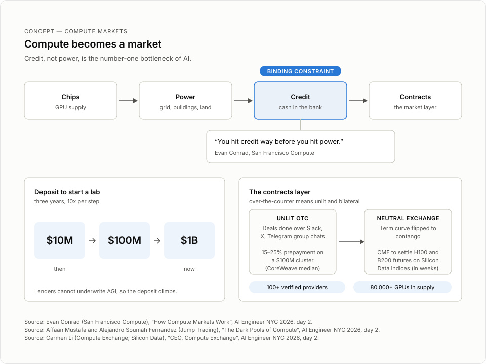

# How Compute Markets Work

> Evan Conrad of San Francisco Compute explains why a compute market only works if it is physically settled, why credit (not power) is the number-one AI bottleneck, and what happens to startups if nobody builds one.

## TL;DR
- A compute market must be physically settled. The market operator must also operate the clusters. San Francisco Compute is both, "kind of like a grid for compute."
- Credit, not power, is the number-one bottleneck of AI. Lenders cannot underwrite AGI, so the deposit to start a lab climbed from $10 million to $1 billion in three years.
- SFC found the market by accident. Its first company went underwater on a cluster lease and became "the first GPU broker" to survive.
- Reserved take-or-pay contracts finance clusters but kill liquidity. Fast-growing customers wait through lead times for new clusters instead.
- Without a market, compute consolidates TSMC-style: a few clouds, a few labs, and no startups. "There is no rule that says that startups have to exist."

## Key lessons
1. Physical settlement forces vertical control. SFC is "both the operator of the hardware in the same way that a cloud is the operator of the hardware, and then we're also the market at the same time" [02:50:27-02:50:38]. On top of this it runs a live order book for capacity bought reserved now or in the future [02:51:50-02:51:58].
2. Running a supercomputer starts at the bill of materials and extends through the backplane fabric, bare-metal orchestration, and services such as VMs [02:50:40-02:51:03]. Data center owners who skip this "end up failing for the customer" [02:51:07-02:51:20]. SFC sells this as "supercomputing as a service" to would-be NCPs, venture firms that want reallocateable portfolio capacity, and AI companies that want residual value without operating a supercomputer [02:51:22-02:51:48].
3. Credit, not power, is the number-one AI bottleneck: "You hit credit way before you hit power" [02:58:15]. Every inference company and neolab is limited by how much cash it has in the bank, so VCs end up funding the cluster deposit indirectly through model-layer checks [02:58:20-02:58:53].
4. Lenders underwrite the customer's credit risk, not the cluster. So clouds cannot deploy until a customer signs, which makes "right when the customer signs ... the riskiest point in the entire operation" [02:54:58-02:55:05]. The correct order is to build the cluster first, land it, then sell it [02:59:06-02:59:17].
5. Take-or-pay contracts with investment-grade credit are the only way to finance GPU clusters [02:57:27-02:57:35], but they block liquidity. A customer whose product is taking off (named as Instinct) cannot buy capacity now and must finance a new cluster with a lead time, sometimes including a new data center [02:57:35-02:57:56].
6. AI margins are not SaaS margins. A SaaS company whose cloud doubles prices is angry but alive; an AI company goes bankrupt [02:57:00-02:57:07]. That price sensitivity prevents on-demand sales and pushes the market into long contracts.
7. Brokering clusters cannot work. The hotel analogy: if you buy a resold hotel room, "Who do I call?" for room service or repairs [03:02:13-03:02:27]. "You have to operate the cluster like the hotel. You have to run the whole damn thing" [03:02:33-03:02:36].
8. The ante to start a lab rose from a $10 million deposit to $100 million to $1 billion [03:03:44-03:03:59]. Projecting the line, founders will need to buy $100 million of tokens to compete [03:05:53-03:06:03], and the default outcome is consolidation into "one big creditworthy customer," a TSMC-like structure with a few clouds and labs [03:00:40-03:00:57].

## Figures



The market map: chips, power, credit as the binding constraint, and contracts.

## Notable quotes
"When we say physically settled, we mean we're the operator." [02:50:27 | 11:31:03 AM]

"You hit credit way before you hit power." [02:58:15 | 11:38:50 AM]

"You have to operate the cluster like the hotel." [03:02:33 | 11:43:09 AM]

"There is no rule that says that startups have to exist." [03:05:15 | 11:45:51 AM]

## Session narrative
The session opens cold at 02:49:59 with no host introduction. Evan Conrad frames it immediately: "this is a talk about compute markets, but it's kind of more of a talk about why to make a compute market." He introduces himself and San Francisco Compute, which makes a physically settled forwards market. Physically settled means SFC operates the hardware like a cloud and runs the market at the same time, "kind of like a grid for compute." He then positions the product: supercomputing as a service for data center owners who want to become GPU clouds (NCPs in Nvidia's terms), venture firms that want to reallocate portfolio capacity, and AI companies that want residual value on compute without operating a supercomputer. Above the hardware sits a live order book for reserved capacity, deliverable now or in the future.

The middle third is the origin story. The founders first tried to build an AI lab (rendered "June Lark" in the transcript) that would make something like Suno or Udio before those products existed. The entry deposit for a lab was $10 million at the time. They raised 500 thousand dollars instead, bought a cluster, and went underwater every month. Subleasing kept them out of bankruptcy and made them, in Conrad's words, "the first GPU broker." He sold capacity at NeurIPS with paper posters that said both H100 and A100. The framing device for the rest of the talk is a pamphlet: the front says starting a neolab is painful, the back says "compute markets," and the inside unfolds into many hard problems. A compute market needs two miracles at once: making a market, which has a cold-start problem, and building a cloud without becoming a cloud.

The core argument walks the risk chain. Everyone is sold out because lenders require long-term take-or-pay contracts with investment-grade credit. AI companies lack SaaS margins, so a cloud that doubles its prices bankrupts an AI customer; that price sensitivity kills on-demand sales. Credit, not power, is the number-one bottleneck. Clusters are delayed because lenders underwrite customer credit risk, so clouds wait for a signed customer before deploying, which is the riskiest moment in the operation. Nodes break, RMAs reintroduce lead time, and buyers with no liquidity overbuy or underbuy, "become Stability AI or ... end up like Character AI." Conrad's fix is to underwrite the value of the GPU cluster rather than the credit risk of the customer. The alternative is consolidation: a TSMC-like market of a few clouds and a few labs with no startups.

The final third defends physical settlement. Dylan Page, co-chair of the CNCF Infrastructure Group (the organization that makes Kubernetes) and formerly of Lambda, joined SFC because GPU compute is not standardized or reliable enough to separate the market operator from the physical infrastructure. Conrad's hotel analogy explains why brokering fails: buy a resold room and there is nobody to call for room service. The incentive problem is stark: physical settlement means building the entire operating capacity of a GPU cloud, and a cloud "will make an ungodly amount of money," signing billion-dollar deals, so almost everyone just becomes a cloud. SFC chose the market because without it they could never have started their lab. The deposit ante rose from $10 million to $100 million to $1 billion, and Conrad projects founders will need $100 million of tokens just to compete. He closes on a sequence of small startups he wants to exist, maybe building cancer cures, then delivers the punchline that there is no rule that startups must exist, and ends with "Cool. That's it. That's the talk."

## Speaker details
**Evan Conrad** - CEO, San Francisco Compute Company. Co-founder and CEO of SFC, founded in 2023. Before SFC he co-founded Room Service, a distributed systems startup, and worked as an engineer at Segment. He contributed to OpenAI's ChatGPT Enterprise and ran admissions for the first batch of Nat Friedman and Daniel Gross's venture fund, AI Grant. He holds a degree from Gonzaga University. Links: [LinkedIn](https://www.linkedin.com/in/evan-conrad/), [Twitter](https://x.com/evanjconrad), [Website](https://sfcompute.com/)

## Full timestamped transcript
```
[02:49:59 | 11:30:35 AM] So this is a talk about compute markets, but it's kind of more of a talk about why to make a compute market.
[02:50:08 | 11:30:44 AM] If you don't know me, I'm Evan.
[02:50:11 | 11:30:47 AM] We run a company called San Francisco Compute.
[02:50:14 | 11:30:49 AM] We make a physically settled order, physically settled forwards market.
[02:50:18 | 11:30:54 AM] So if you were here for the last talk, the last talk was basically why all the operators of GPU clusters don't really work very well.
[02:50:27 | 11:31:03 AM] When we say physically settled, we mean we're the operator.
[02:50:31 | 11:31:07 AM] We're both the operator of the hardware in the same way that a cloud is the operator of the hardware, and then we're also the market at the same time.
[02:50:38 | 11:31:14 AM] It's kind of like a grid for compute.
[02:50:40 | 11:31:16 AM] So the general gist of this is that in order to run and operate a supercomputer, we think problems start right at the design of the supercomputer, right in the design of the bill of materials, its control of the backplane fabric as well.
[02:50:58 | 11:31:33 AM] It's also control of bare metal orchestration.
[02:51:00 | 11:31:36 AM] It's also services on top, VMs and so on.
[02:51:03 | 11:31:39 AM] There's a lot of different parts of the stack that you have to do effectively.
[02:51:07 | 11:31:42 AM] Otherwise, the folks who have a data center and would like to make more money on that data center by becoming the GPU cloud end up failing for the customer.
[02:51:20 | 11:31:56 AM] So that's what we do.
[02:51:22 | 11:31:58 AM] We offer what's called supercomputing as a service.
[02:51:25 | 11:32:00 AM] We go to folks who want to become a cloud.
[02:51:27 | 11:32:02 AM] That's like folks who want to become what Nvidia would call an NCP, or venture firms that want to have clusters for their portfolio and want to be able to reallocate that capacity when a company like Instinct is taking off, or AI companies who would like the residual value on the compute because they've realized that's really important for their financials, but don't want to operate a supercomputer.
[02:51:48 | 11:32:24 AM] So that's physical settlement.
[02:51:50 | 11:32:26 AM] And then on top of that, we run a live order book for capacity that you can buy reserved, either right now or in the future.
[02:51:58 | 11:32:33 AM] This together is not at all what we thought we were going to be doing.
[02:52:03 | 11:32:39 AM] Originally, we were this company called June Lark that was trying to make kind of like Suno or Udio, but prior to Suno or Udio.
[02:52:11 | 11:32:47 AM] At the time, what you needed to do to realistically start a lab was you needed to raise a big deposit, a huge one, which was $10 million at the time.
[02:52:22 | 11:32:58 AM] We thought that was a crazy amount of money, and so we thought, no, that's stupid.
[02:52:25 | 11:33:01 AM] We're going to raise 500K, and obviously what we're going to do is we're going to rent from somebody else.
[02:52:31 | 11:33:07 AM] Obviously today, it's not $10 million, it's a billion dollars.
[02:52:35 | 11:33:11 AM] And nonetheless, we had raised our 500K, we buy a big cluster, and then we're underwater on our cluster every month.
[02:52:44 | 11:33:20 AM] And if we didn't sublease our cluster, we would have gone bankrupt.
[02:52:48 | 11:33:23 AM] So if you've heard of GPU brokers, we were the first GPU broker because we were forced into being a GPU broker.
[02:52:52 | 11:33:28 AM] So the first year of the company was us just trying to sell our cluster, otherwise we would go bankrupt.
[02:52:57 | 11:33:33 AM] So I would wander around with these, like, actual pieces of paper at NeurIPS, which both say H100 and A100 at the same time, because that's how I made the posters so quickly.
[02:53:11 | 11:33:47 AM] And so this talk is not really about necessarily, like, how a compute market works.
[02:53:17 | 11:33:53 AM] It's how a compute market gets to exist.
[02:53:21 | 11:33:57 AM] We like to think about it like there's this pamphlet, and on the pamphlet, on the front side, it's like, man, starting a neolab sucks.
[02:53:27 | 11:34:03 AM] There's all these different, like, financial and economic problems.
[02:53:30 | 11:34:05 AM] On the back of the pamphlet, it says, compute markets.
[02:53:34 | 11:34:10 AM] It's not super clear how one gets to the other until you open the pamphlet and then, like, holy shit, there's, like, so much stuff in this pamphlet, and it keeps going, and there's so many folds.
[02:53:43 | 11:34:18 AM] It's just a very difficult and challenging problem because you need to solve two, like, miracle problems to get working.
[02:53:48 | 11:34:24 AM] You have to both make a market, which is a uniquely difficult problem because it has a cold start problem.
[02:53:54 | 11:34:29 AM] You also have to build a cloud, and then you have to not become a cloud, which is a whole separate challenge.
[02:53:59 | 11:34:35 AM] But these are the problems that the labs are facing, and it's about to be the problems that everyone is about to facing.
[02:54:05 | 11:34:40 AM] So if you work at a startup, these are your problems now.
[02:54:08 | 11:34:43 AM] Right now, everybody is sold out of compute.
[02:54:10 | 11:34:46 AM] This is probably not going to change for a while.
[02:54:15 | 11:34:51 AM] So that means that you're going to have to buy a new cluster, a net new one, and there's a lead time.
[02:54:19 | 11:34:55 AM] You have no way to pay for that cluster to come online now.
[02:54:22 | 11:34:58 AM] You're going to pay for it to come online later.
[02:54:24 | 11:35:00 AM] There's nothing in the market that can realistically get that cluster online for you now.
[02:54:28 | 11:35:04 AM] Meanwhile, you're going to pay your entire bank balance as a deposit.
[02:54:33 | 11:35:08 AM] The reason you're paying your entire bank balance as a deposit is because the lender has no idea how to underwrite AGI.
[02:54:39 | 11:35:15 AM] How in the world are you supposed to do that?
[02:54:41 | 11:35:17 AM] You've got two-person startups in San Francisco, who, or maybe New York, who say, I'm going to build superintelligence.
[02:54:49 | 11:35:24 AM] No lender knows how to underwrite superintelligence, so they have no idea what the asset is worth.
[02:54:55 | 11:35:30 AM] Meanwhile, your cluster is very likely to be delayed.
[02:54:58 | 11:35:34 AM] That's because the lender needed to underwrite against the credit risk of the customer, and so they needed to know who is the customer first before you deploy the cluster.
[02:55:05 | 11:35:41 AM] So right when the customer signs is the riskiest point in the entire operation.
[02:55:10 | 11:35:45 AM] You wanted it to be the case that you built the cluster first and then you sell it.
[02:55:14 | 11:35:49 AM] This also helps reduce all sorts of different types of problems where clusters break.
[02:55:18 | 11:35:54 AM] Meanwhile, most of the people who are setting up clusters are people who have the actual asset that makes the thing cheap, like you've got the data center space already.
[02:55:27 | 11:36:03 AM] What that doesn't get is supercomputing expertise.
[02:55:30 | 11:36:05 AM] As we saw in the last talk, if you've watched that one.
[02:55:34 | 11:36:10 AM] Meanwhile, you're going to run into the exact same problem that Jun Lark did, which is you're going to either way overbuy or you're going to way underbuy.
[02:55:42 | 11:36:17 AM] That's because AI doesn't have margins that look like SaaS companies, and so you don't have very much margin for error.
[02:55:47 | 11:36:23 AM] And so the chances that you either underbuy and somebody else wins because they did it correctly, or you overbuy and then you just become Stability AI or you blow up, you end up like Character AI, are really high.
[02:56:00 | 11:36:35 AM] So these are all the same problem.
[02:56:01 | 11:36:36 AM] They're all just different types of risk.
[02:56:03 | 11:36:38 AM] They're technical risk, they're financial risk, they're credit risk.
[02:56:06 | 11:36:41 AM] They're all one big bundled risk problem, which is the problem that we end up solving, and it's also the problem that we think compute markets broadly, the entire industry solves.
[02:56:15 | 11:36:50 AM] So we'll walk through each one of these and walk how that gets to a compute market, because if you don't understand these, it's kind of like unclear why you would want a compute market.
[02:56:22 | 11:36:58 AM] And they almost seem like this problem that somebody thinks, Oh wow, compute markets are cool, so I'm going to go start one.
[02:56:27 | 11:37:03 AM] We think they should be derived from the actual problems that people face, which is first, everyone is sold out.
[02:56:33 | 11:37:08 AM] Why are they sold out?
[02:56:34 | 11:37:09 AM] Because the lender couldn't finance the cluster unless you had a long-term offtake agreement.
[02:56:38 | 11:37:14 AM] In CPUs, this wasn't the case because CPU buyers are SaaS companies.
[02:56:44 | 11:37:19 AM] SaaS companies have high margins, and because they have high margins, you can build a product that rewards you with high margins for your CPUs.
[02:56:58 | 11:37:34 AM] Think about it like this way.
[02:57:00 | 11:37:35 AM] If you're a SaaS company and your underlying cloud doubles their prices, you don't go bankrupt.
[02:57:04 | 11:37:40 AM] You hate your cloud.
[02:57:06 | 11:37:41 AM] You're mad, but you don't go bankrupt.
[02:57:07 | 11:37:43 AM] If you're an AI company and your underlying cloud doubles their prices, you go bankrupt unless you go to some other underlying cloud.
[02:57:13 | 11:37:49 AM] And what that means is that you're actually price sensitive.
[02:57:16 | 11:37:51 AM] And because you're actually price sensitive, and there's nothing keeping you at any particular cloud, so you can't sell on demand because your customers will immediately leave to whoever is cheaper.
[02:57:27 | 11:38:02 AM] And so that means that in order to finance GPU clusters, you have to have long-term take-or-pay contracts, hopefully with someone who has investment grade credit.
[02:57:35 | 11:38:11 AM] However, if you don't have liquidity on those, if you're selling reserved and your customer can't get out, then that also means that some other customer who wants the capacity right now because they're like instinct and their product is taking off can't pay for anything.
[02:57:47 | 11:38:23 AM] They have to finance a new cluster, which has a lead time because the physical world just exists and it's going to take a while.
[02:57:53 | 11:38:28 AM] Sometimes you even have to build a damn data center.
[02:57:56 | 11:38:31 AM] And then because you're financing a new cluster, you're going to pay a deposit because almost nobody in AI has any reasonable credit.
[02:58:02 | 11:38:38 AM] And because this is a brand new technology, all these companies are new.
[02:58:06 | 11:38:42 AM] Meanwhile, even as you start to scale up that ladder, you're still going to run into credit issues all the way through.
[02:58:12 | 11:38:48 AM] It's the number one bottleneck of AI at the moment.
[02:58:14 | 11:38:49 AM] It's not power.
[02:58:15 | 11:38:50 AM] You hit credit way before you hit power.
[02:58:20 | 11:38:55 AM] So what that means is every inference company, every NeoLab, their bottlenecks by how much cash do they have in the bank account.
[02:58:28 | 11:39:03 AM] And so they go back to the venture capitalist who says, Oh, I'm going to fund at the model layer, the application layer, the inference layer, because I don't want to fund all of that CapEx stuff.
[02:58:37 | 11:39:12 AM] And so the venture capitalist then funds all the CapEx stuff by giving the new NeoLab or new inference company the check that they then send to the cloud, which is The deposit for the cluster, and that's how you underwrite the customer.
[02:58:53 | 11:39:29 AM] So, the clusters then are delayed because the cloud couldn't actually deploy the cluster until they had the customer in hand.
[02:59:04 | 11:39:39 AM] And so that was the riskiest point.
[02:59:06 | 11:39:41 AM] So therefore, what should have happened was the cloud had bought the cluster ahead of time and then waited until it was landed in the data center and then sold it.
[02:59:17 | 11:39:52 AM] And that means you have way less likelihood of delays.
[02:59:20 | 11:39:55 AM] Meanwhile, the cluster is very likely to break when you get the cluster as the customer because you don't have liquidity.
[02:59:26 | 11:40:01 AM] And so if the failure rate is higher than what you expect and you don't have the ability to transition a node in, then you don't have anywhere you can pull nodes from, which means that if you need new nodes to make up for the failed ones, you have to RMA them, which means you have to get a new node.
[02:59:40 | 11:40:16 AM] And then that gets us back to several steps before where you have the lead time problem again.
[02:59:46 | 11:40:22 AM] And so everything breaks for everybody all the time.
[02:59:50 | 11:40:25 AM] Once you have gotten through all of that as a new AI lab, your problems are, you know, nobody was sold, like everyone was sold out.
[02:59:57 | 11:40:33 AM] You then had to wait.
[03:00:10 | 11:40:45 AM] and had to wait a lead time.
[03:00:11 | 11:40:47 AM] You pay this big deposit.
[03:00:12 | 11:40:47 AM] The thing was delayed, and then it broke.
[03:00:14 | 11:40:49 AM] And finally, you got through all of that.
[03:00:16 | 11:40:52 AM] And the likelihood that you predict your demand correctly is very low.
[03:00:19 | 11:40:55 AM] And so you're either going to be way overprovisioned or way underprovisioned, and you have no way out.
[03:00:23 | 11:40:59 AM] There's no way to sell your capacity to somebody else, and there's no way to buy more capacity if you need it.
[03:00:31 | 11:41:06 AM] So, compute markets.
[03:00:31 | 11:41:06 AM] To solve these problems, you need to solve a bunch of different problems all at once.
[03:00:32 | 11:41:07 AM] You need to underwrite the value of the GPU cluster rather than underwriting the value, underwriting the credit risk of the customer.
[03:00:36 | 11:41:11 AM] This is how it could work.
[03:00:38 | 11:41:13 AM] It's not guaranteed to work like this.
[03:00:40 | 11:41:16 AM] In other industries, what happened is everything just consolidated.
[03:00:46 | 11:41:21 AM] You got one big creditworthy customer that does the whole damn industry.
[03:00:49 | 11:41:24 AM] That's what the path of AI is currently on track to do.
[03:00:52 | 11:41:28 AM] It's instead of going to be a liquid market where anybody can participate, it's going to look like TSMC.
[03:00:56 | 11:41:31 AM] You're going to get one buyer or a few buyers that are the clouds.
[03:00:57 | 11:41:32 AM] You're going to get a few model labs that are the AI labs, and then you won't get other startups.
[03:01:00 | 11:41:35 AM] This is what we think is going to happen, and this is why three years ago, when we were doing our AI lab, we had a chance.
[03:01:06 | 11:41:42 AM] We could have said, no, we're not going to do our new, we're not going to, like, stick it out for several years just trying to keep our company alive.
[03:01:15 | 11:41:50 AM] We're just going to go do a new AI lab.
[03:01:17 | 11:41:53 AM] But we saw this problem, and we said, oh shit, if we don't do anything about this, then we will just hit this three years from now.
[03:01:24 | 11:42:00 AM] And here we are three years from now hitting this problem, and where everyone's going to hit this problem.
[03:01:32 | 11:42:07 AM] So, as if you watched the last talk, it's very hard to solve this problem unless you are operating both the market and the clusters at the same time.
[03:01:39 | 11:42:15 AM] So this is Dylan Page.
[03:01:41 | 11:42:16 AM] Dylan is the co-chair of the CNCF Infrastructure Group.
[03:01:44 | 11:42:20 AM] That's the organization that makes Kubernetes.
[03:01:46 | 11:42:21 AM] He formerly worked at Lambda doing infrastructure there, and he joined the San Francisco Compute because GPU compute.
[03:01:53 | 11:42:29 AM] isn't sufficiently standardized or reliable for the market operator to be divorced from the physical infrastructure.
[03:01:58 | 11:42:33 AM] It doesn't work if you aren't the one who's buying the thing.
[03:02:01 | 11:42:37 AM] Sorry, it doesn't work if the person you're buying from isn't operating it.
[03:02:04 | 11:42:40 AM] To give an example of why this doesn't work is I'm sure some of you are flying in from overseas or out of town, and you have a hotel room.
[03:02:13 | 11:42:48 AM] Wouldn't it be great if you could, you know, sell that hotel room to somebody else?
[03:02:18 | 11:42:53 AM] I go to you and I want to buy that hotel room, and I say, can I get room service?
[03:02:22 | 11:42:58 AM] Can I get my room cleaned?
[03:02:24 | 11:43:00 AM] I've got a problem with my room.
[03:02:26 | 11:43:02 AM] Who do I call?
[03:02:27 | 11:43:03 AM] If you don't operate the hotel, you can't fix any of those problems.
[03:02:31 | 11:43:07 AM] That's why brokering clusters doesn't work.
[03:02:33 | 11:43:09 AM] You have to operate the cluster like the hotel.
[03:02:36 | 11:43:11 AM] You have to run the whole damn thing.
[03:02:38 | 11:43:13 AM] Otherwise, you can't actually make a market.
[03:02:40 | 11:43:16 AM] It doesn't work.
[03:02:41 | 11:43:16 AM] You can't do physical settlement.
[03:02:43 | 11:43:18 AM] So why does nobody do physical settlement?
[03:02:46 | 11:43:22 AM] The problem is there's a very strong incentive to never do physical settlement.
[03:02:50 | 11:43:26 AM] That's because if you build out physical settlement for compute, what that literally means is you're building out the entire operating capacity of a GPU cloud.
[03:02:58 | 11:43:34 AM] And if you are building out the entire operating capacity of a GPU cloud, you should just be a GPU cloud because it looks to be the case that you will make an ungodly amount of money.
[03:03:09 | 11:43:44 AM] You will sign billion dollar deal after billion dollar deal.
[03:03:17 | 11:43:53 AM] And so, fuck it.
[03:03:20 | 11:43:56 AM] Let's not make a compute market.
[03:03:22 | 11:43:57 AM] Let's instead just become a GPU cloud, which is what basically everybody does because the numbers are astronomical and it's a very reasonable thing to do.
[03:03:30 | 11:44:05 AM] The reason why we ended up building physical settlement was because we knew that if we didn't start this, we would then not be able to start an AI lab, which was the real damn thing that we wanted to do in the first place.
[03:03:40 | 11:44:16 AM] We wanted to make a lab.
[03:03:42 | 11:44:18 AM] We didn't get to make a lab unless this exists.
[03:03:44 | 11:44:19 AM] So when we started, it was 10 million as the deposit that you had to pay to start a new lab.
[03:03:48 | 11:44:24 AM] This is like how you get over the credit risk problem.
[03:03:51 | 11:44:26 AM] Then the cluster sizes got bigger.
[03:03:53 | 11:44:29 AM] The sort of minimum ante into the space got bigger.
[03:03:57 | 11:44:32 AM] Then it was 100 million.
[03:03:58 | 11:44:34 AM] Now it's a billion.
[03:03:59 | 11:44:35 AM] We don't think it can continue.
[03:04:01 | 11:44:36 AM] We don't think there is a world in which you can get a $10 billion round right out the bat before you raise, before you have revenue or traction or your product or anything.
[03:04:10 | 11:44:45 AM] And what that means is that if you don't solve this problem, we are currently on track to not have any startups in AI.
[03:04:16 | 11:44:52 AM] Now, one of the things that you could think could happen is maybe there can be new inference companies and new model labs.
[03:04:24 | 11:44:59 AM] And the way that they solve the credit problem is that instead they just shift the risk to the application layer.
[03:04:30 | 11:45:06 AM] They say, look, I need to get over my credit problem.
[03:04:34 | 11:45:10 AM] So what I'm going to do is I'm going to only sign customers who are investment grade credit, you know, Fortune 500.
[03:04:43 | 11:45:18 AM] I'm going to only sign customers on five-year contracts for tokens.
[03:04:47 | 11:45:22 AM] I'm going to only sign customers for tokens that require a big deposit upfront.
[03:04:54 | 11:45:30 AM] That is the end of everything.
[03:04:57 | 11:45:33 AM] If you have inference layer getting bottlenecked by credit, what happens is you can't get tokens unless you have credit or you have a big deposit.
[03:05:07 | 11:45:43 AM] And the problem of that is that tokens are used by the whole damn economy.
[03:05:11 | 11:45:47 AM] There is no rule that says that startups have to exist.
[03:05:15 | 11:45:51 AM] If every startup is suddenly bottlenecked by credit in order to access intelligence, what happens is existing firms just ship everything.
[03:05:24 | 11:46:00 AM] They themselves get to make the product because they've got credit, and then they make the revenue from that product, and then it makes their credit better.
[03:05:33 | 11:46:09 AM] And that's a flywheel that makes consolidation happen throughout the entire economy.
[03:05:37 | 11:46:12 AM] If you don't fix this bottleneck, there aren't any startups.
[03:05:40 | 11:46:15 AM] This is why we started doing this, and because at one point.
[03:05:43 | 11:46:19 AM] Or what we think is going to happen is you're going to end up in like three to five years, you're going to look out and say, I want to start a new startup.
[03:05:53 | 11:46:28 AM] And to get there, you need to buy so many tokens in order to compete with the existing partner or like existing players.
[03:06:00 | 11:46:35 AM] So you need to buy $100 million of tokens.
[03:06:03 | 11:46:39 AM] We think this is what you are actually going to have to do in order to start a new company, because other people are spending hundreds of millions of dollars of tokens.
[03:06:11 | 11:46:47 AM] If you just draw the line out, this is what happens.
[03:06:14 | 11:46:50 AM] So you need a big giant deposit because you're two people who have no idea what they're doing, and so nobody trusts you.
[03:06:20 | 11:46:56 AM] So you're going to go and raise $100 million from your venture capitalist.
[03:06:24 | 11:46:59 AM] Meanwhile, nobody wants to work with you because you're a two-person startup.
[03:06:28 | 11:47:04 AM] Then you're going to be asked to pay for that hundred, or you're going to be asked to pay for a five-year contract on that hundred million if you're not paying it all as a deposit.
[03:06:34 | 11:47:10 AM] And then you just don't get new model labs.
[03:06:37 | 11:47:12 AM] You don't get new startups.
[03:06:38 | 11:47:14 AM] You get a consolidation in the industry.
[03:06:41 | 11:47:16 AM] So we, at one point, were this little lab.
[03:06:45 | 11:47:20 AM] And what we did is we lived in San Francisco, and we knew all the other people who were also just two little folks who had started a startup and wanted to be able to participate in the most important technology of our time.
[03:06:59 | 11:47:35 AM] So I want these people to exist.
[03:07:01 | 11:47:37 AM] I want this person to exist, and I want this person to exist.
[03:07:05 | 11:47:40 AM] I want this startup to exist, and this startup to exist, and this startup to exist.
[03:07:09 | 11:47:44 AM] This one, and this one, and this one, and this one, and this one, and this one, and this one.
[03:07:14 | 11:47:49 AM] If you get these companies going, maybe they'll become big folks that build your cancer cures, or they build something that nobody thought of, or something that wasn't just sort of AI slopped out.
[03:07:24 | 11:48:00 AM] This is kind of the problem that compute markets solve.
[03:07:28 | 11:48:03 AM] And if you don't solve it, we don't think there's going to be any startups.
[03:07:33 | 11:48:08 AM] Cool.
[03:07:33 | 11:48:09 AM] That's it.
[03:07:35 | 11:48:10 AM] That's the talk.
[03:07:36 | 11:48:12 AM] Yeah.
```
