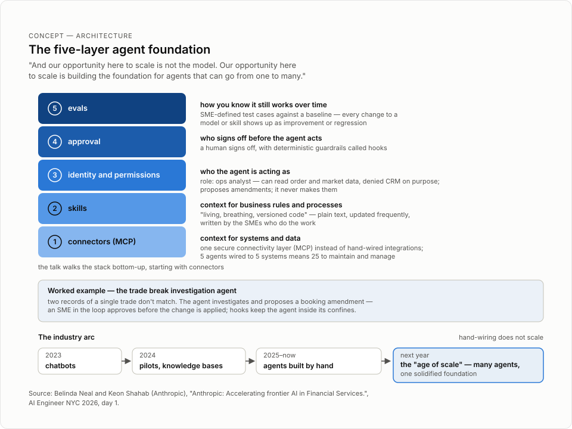

# Anthropic: Accelerating frontier AI in Financial Services.

> Anthropic's Belinda Neal and Keon Shahab argue that model intelligence now runs far ahead of adoption in financial services, and they lay out a five-layer agent foundation (MCP connectors, skills, identity and permissions, approval, evals) plus Claude for Financial Advisors as the proof that the same pattern scales from one firm to a whole industry.

## TL;DR
- Intelligence is ahead of adoption: what a model can do on its own doubles every four months, yet three quarters of the economic gains of AI go to a fifth of companies. Anthropic calls this the diffusion gap, and sees it as the room's opportunity.
- The model is now the easiest part. Firms scaling from a few hand-built agents to many need a shared foundation: connectors via MCP, SME-written skills, identity and permissions, a human approval layer with deterministic hooks, and evals.
- Finance deployments are already real: Citadel investment professionals use Claude for Excel, a Millennium PM used Fable to find a five-year-old unexplained code bug, one bank cut $120 million of potential auto-loan fraud in 12 months, and post-earnings research drafts dropped from 45 minutes to 15.
- Claude for Financial Advisors (launched September) applies the framework at industry level: 25 connector platforms, a GitHub plugin with eight out-of-the-box skills, and the rule that the advisor approves everything before it is saved or sent.
- The close gave the room three questions to take home: the workflow (where is your edge), the foundation (can you trust it as you scale), and the connector (what are you building for your users, your firm, and the industry).

## Key lessons
1. The diffusion gap is the opportunity. What a model can do on its own doubles every four months, and PwC published early in 2026 that three quarters of the economic gains of AI go to a fifth of companies. Firms that build close enough to the frontier curve can convert that gap into edge and alpha.
2. The frontier keeps compounding on three axes at once: models can now work 16-plus hours on their own (up from minutes in 2023), Opus 5.5 is 40% more cost-efficient than Opus 5, and Fable 5.1 lets only 1% of prompt injection attacks succeed, against roughly 9 to 53% for other frontier models.
3. Threshold crossings change how work is done, and finance is next. Coding crossed last year with Opus 4.5 and Claude Code (from autocomplete to managing fleets of agents); cyber crossed this year with the Claude Mithos preview; Belinda Neal's answer to "What's next?" was "Finance."
4. Named, citable production results anchor the story: Citadel's investment professionals get a step change in testing, building, and trusting their work with Claude for Excel; a Millennium PM used Fable to find a code bug that had gone unexplained for five years; the Evident AI 2026 report (out the week before) showed banks 26% ahead on AI maturity scores, including the $120 million auto-loan fraud reduction and the 15-minute post-earnings draft.
5. The industry arc is 2023 chatbots, 2024 pilots and knowledge bases, 2025-to-now agents built one by one by hand, and next year the "age of scale": many agents on one solidified foundation. Hand-wiring does not scale — five agents wired to five systems means 25 connections to maintain, so route access through one secure connectivity layer, MCP.
6. The five-layer framework, shown on a trade break investigation agent: (1) connectors via MCP so the agent reaches systems and data; (2) skills — "living, breathing, versioned code," plain text written and frequently updated by SMEs; (3) identity and permissions — the agent gets a role ("ops analyst") that can read order and market data but is denied CRM on purpose, and proposes amendments rather than making them; (4) approval — a human signs off before the agent acts, with deterministic guardrails called hooks around it; (5) evals — SME-defined test cases and a baseline so any change to a model or skill shows up as improvement or regression.
7. Claude for Financial Advisors shows the pattern compounding at industry level. Built on the stat that advisors spend only about 20% of their time with clients, the September launch brought in 25 platforms across custody, portfolio, planning, data, and CRM (Schwab, Adapar [likely Addepar], Salesforce, and more on the Claude Marketplace), shipped a GitHub plugin with eight skills and workflows (for example pre-meeting prep and meeting-notes follow-up), and kept layer four intact: nothing is saved or sent without the advisor's approval.
8. Access and operating model matter as much as architecture. The same foundation has four doors — Claude CoWork for business users, Claude Code for engineers, Managed Agents or Agent SDK for your own UI — and the business now works directly with the agent, proposing corrections while engineering stays in the loop, with evals gating what becomes a scaled change.

## Figures



The agent foundation stack, walked through on the trade-break example.

## Notable quotes

> "Intelligence is ahead of adoption. What a model can do on its own is doubling every four months." — [00:34:18 | 9:22:10 AM]

> "And our opportunity here to scale is not the model. Our opportunity here to scale is building the foundation for agents that can go from one to many." — [00:37:26 | 9:25:18 AM]

> "For us, financial services and regulated industries doesn't mean slow." — [00:44:19 | 9:32:10 AM]

> "This is where the industry builds once, the advisor can integrate once, and this is what compounding looks like." — [00:48:55 | 9:36:47 AM]

## Session narrative

The host introduced the second keynote of the morning at [00:31:21 | 9:19:12 AM]: two speakers from Anthropic, Belinda Neal, Managing Director of Financial Services, and Keon Shahab, Applied AI Architect. Neal opened with her own background — 19 years at Goldman Sachs across engineering, global markets, and equity research before joining Anthropic that year — and framed her role at the confluence of industry, product, research, and go-to-market. Shahab added his five years at Databricks helping financial services firms modernize data and AI architecture. They set out three ideas for the talk: the frontier of intelligence, the frontier of adoption, and an application to financial services through Claude for Financial Advisors.

Neal took the first part. Every so often a model crosses a threshold and a way of working changes: coding crossed last year with Opus 4.5 and Claude Code, where users went from autocomplete to managing fleets of agents; cyber crossed this year with the Claude Mithos preview; "What's next? Finance." She cited Citadel's investment professionals using Claude for Excel for a step change in how they test, build, and trust their work, then named the central problem — intelligence is ahead of adoption — and the PwC finding that three quarters of AI's economic gains go to a fifth of companies: the diffusion gap. She walked the model family (Haiku for speed and volume, Sonnet for everyday work, Opus as the financial services daily driver, Fable for the hardest work), a Millennium PM's Fable find of a five-year unexplained code bug, and frontier metrics: 16-plus hours of autonomous work (up from minutes in 2023), Opus 5.5 at 40% better cost efficiency than Opus 5, and Fable 5.1 blocking all but 1% of prompt injection attacks versus 9 to 53% for other frontier models. From the Evident AI 2026 report out the prior week, she added banks' 26% AI maturity lead, a $120 million auto-loan fraud reduction in 12 months, and post-earnings research drafts generated in 15 minutes instead of 45. She then set up the hand-off: 2023 built chatbots, 2024 brought pilots and knowledge bases, 2025 to now builds agents one by one by hand — so the opportunity to scale is not the model, it is the foundation.

Shahab took the middle section: going from experimentation to productionizing and scaling agents. He framed a year ago as the year of exploration (POCs and pilots), this year as the age of production (a handful of hand-built agents), and next year as the age of scale — many agents on one solidified foundation. He walked the five layers using a trade break investigation agent that examines two records of a single trade that do not match: connectors through one secure MCP layer rather than 25 hand-wired integrations; skills as "living, breathing, versioned code" — plain text from the SMEs who do the work; an identity and permissions layer giving the agent the "trade break investigator" identity and "ops analyst" role, allowed to read order and market data but denied CRM on purpose, and limited to proposing amendments; an approval layer where a human signs off before any booking amendment is applied, with deterministic guardrail hooks keeping the agent inside its confines; and an evals layer where SMEs define test cases against a baseline so every variable change shows as improvement or regression. He closed the section with the line that "financial services and regulated industries doesn't mean slow," mapped four access doors onto the same foundation (Claude CoWork for business, Claude Code for engineers, Managed Agents and Agent SDK for your own UI), and described the operating model: the business works directly with the agent, proposes corrections with engineering in the loop, and evals gate which adjustments become scaled changes.

Neal returned to apply the pattern beyond a single firm. In September (transcribed once as "Cloudera Financial Advisors"), Anthropic launched Claude for Financial Advisors, an orchestrator across an advisor's stack, built on the finding that advisors spend only about 20% of their time with clients. Layer one brought in 25 connector platforms across custody, portfolio, planning, data, and CRM — Schwab, Adapar, Salesforce, and more on the Claude Marketplace — so the industry builds once and the advisor integrates once. Layer two shipped a GitHub plugin with eight skills and workflows an advisor can use out of the box and amend, such as pre-meeting prep that pulls a full family plan into one brief and a follow-up that files meeting notes into the CRM. Layer four holds the trust principle: the advisor approves everything, and nothing is saved or sent without them. She ended with "28 seconds on the clock" and three questions for firms — the workflow (how are you gaining edge and alpha from frontier models today), the foundation (do you have one you trust for scaling agents as they specialize), and the connector (are you building connectors and skills for your users, your firm, and the industry) — then thanked the room at [00:50:17 | 9:38:08 AM].

## Speaker details

- **Belinda Neal** — Managing Director, Financial Services, Anthropic. Joined Anthropic in April 2026 after 19 years at Goldman Sachs, where she was chief operating officer for core engineering, led product management and engineering partnerships, helped shape the firm-wide AI strategy, and contributed to the GS AI Assistant rollout. At Anthropic she works with financial firms on Claude adoption, including the Millennium partnership to co-develop an AI-powered Digital Risk Analyst and the launch of Claude for Financial Advisors. She studied at London Business School. LinkedIn: https://www.linkedin.com/in/belindaneal/
- **Keon Shahab** — Applied AI Architect, Anthropic. Works with financial services firms on adopting frontier AI and Claude. Before Anthropic he spent about five years at Databricks as a Senior Solutions Architect, helping large financial services organizations adopt the data lakehouse and build enterprise GenAI platforms, and he co-authored the Databricks post "FactSet: Implementing an Enterprise GenAI Platform with Databricks" (June 2024). No public links in the speaker record.

## Full timestamped transcript

```
[00:31:21 | 9:19:12 AM] Coming up next, we're delighted to welcome two speakers from Anthropic.
[00:31:26 | 9:19:18 AM] Please put your hands together for Belinda Neal, Managing Director of Financial Services, and Keon Shahab, Applied AI Architect.
[00:31:49 | 9:19:40 AM] Good morning.
[00:31:50 | 9:19:41 AM] I'm Belinda, and this is Keon, and we're from Anthropic.
[00:31:53 | 9:19:45 AM] We work with financial services firms.
[00:31:57 | 9:19:49 AM] As Keon gets set up here, we'll start with a little bit of background.
[00:32:01 | 9:19:53 AM] My name is Belinda Neal, and I'm the managing director of financial services at Anthropic.
[00:32:06 | 9:19:57 AM] Previously to joining Anthropic this year, I worked at Goldman Sachs for 19 years across engineering, global markets, and equity research.
[00:32:12 | 9:20:03 AM] My role at Anthropic sits at the confluence of our industry, our product, our research, and our go-to-market teams, really in accelerating the adoption of AI within financial services.
[00:32:22 | 9:20:14 AM] Keon.
[00:32:23 | 9:20:15 AM] Good morning, everyone.
[00:32:24 | 9:20:16 AM] Thanks for being here.
[00:32:25 | 9:20:17 AM] My name is Keon Shahab.
[00:32:26 | 9:20:18 AM] I'm an applied AI architect at Anthropic.
[00:32:29 | 9:20:20 AM] Prior to Anthropic, I spent five years at Databricks helping financial services companies modernize their data and AI architecture.
[00:32:35 | 9:20:27 AM] So we're excited to speak to you this morning, and our talk is going to cover three ideas.
[00:32:41 | 9:20:33 AM] Firstly, the frontier of intelligence.
[00:32:44 | 9:20:36 AM] How is this room taking the frontier models and applying it in ways that create alpha or edge within your firm?
[00:32:50 | 9:20:42 AM] The second is the frontier of adoption.
[00:32:53 | 9:20:44 AM] How are you scaling what you've built based on the foundation of a few to many?
[00:32:58 | 9:20:49 AM] And then last, how are we applying it to financial services?
[00:33:00 | 9:20:52 AM] We're going to bring an example in here about how we've been innovating in the wealth industry in Claude for Financial Advisors, and that paradigm compounds potentially to other areas of financial services as well.
[00:33:11 | 9:21:03 AM] So let's get started and talk about the frontier of intelligence.
[00:33:15 | 9:21:07 AM] So every so often, a model crosses a threshold, and when it does, a way of working changes.
[00:33:21 | 9:21:13 AM] We first saw this in coding last year with Opus 4.
[00:33:25 | 9:21:17 AM] 5 and Claude Code.
[00:33:27 | 9:21:18 AM] Many of you in the room are using these tools, and you've gone from autocomplete in coding to managing fleets of agents where you're really driving and accelerating a multiple effect of how you're doing coding.
[00:33:37 | 9:21:29 AM] We also saw this threshold cross this year in cyber with Claude Mithos preview, and many of you are also spending time on the cyber programs in your firms.
[00:33:47 | 9:21:38 AM] What's next?
[00:33:48 | 9:21:39 AM] Finance.
[00:33:49 | 9:21:40 AM] We've started now in finance with early agents and bringing Claude into the products and services that you use day to day.
[00:33:56 | 9:21:47 AM] One example here is Citadel told us at our briefing event in May that their investment professionals started to use Claude for Excel, and it gives them a step change function in how they can test, build, and trust their work.
[00:34:09 | 9:22:01 AM] We're really excited for the potential of Claude within the tools and the use cases that this room is building.
[00:34:15 | 9:22:07 AM] But here's the challenge.
[00:34:18 | 9:22:10 AM] Intelligence is ahead of adoption.
[00:34:20 | 9:22:12 AM] What a model can do on its own is doubling every four months.
[00:34:24 | 9:22:16 AM] PwC published early this year that the capabilities of AI are going to three quarters of companies—sorry, three quarters of the economic gains of AI are going to a fifth of companies.
[00:34:36 | 9:22:28 AM] This is what we call the diffusion gap.
[00:34:38 | 9:22:29 AM] If you're not building close enough to the curve, there's opportunity for you to take the frontier and be able to apply it in your workflows.
[00:34:46 | 9:22:37 AM] We work with firms across financial services, across our model family, most of which hopefully this room is familiar with.
[00:34:52 | 9:22:44 AM] We have Haiku for speed and volume, Sonnet for everyday work, Opus as the daily driver for financial services, complex tasks, and agentic coding, and Fable, our frontier model that can effectively be used for the hardest work in your firms.
[00:35:08 | 9:23:00 AM] One example here from Millennium on our most recent model blog was a PM used Fable to find a piece of code that had a bug, and it was unexplained in five years.
[00:35:20 | 9:23:11 AM] Fable was able to find it.
[00:35:21 | 9:23:13 AM] We're starting to see our models get used in this industry in new and creative ways, and we believe the frontier of intelligence is just getting started.
[00:35:30 | 9:23:21 AM] Every model release gets smarter, cheaper, and safer.
[00:35:32 | 9:23:23 AM] So it's really important to take a minute to call out how the model frontier is continuing to develop here.
[00:35:37 | 9:23:29 AM] Firstly, the intelligence is going up.
[00:35:40 | 9:23:31 AM] Now a model can work for 16-plus hours on its own.
[00:35:43 | 9:23:35 AM] This is up from just minutes in 2023.
[00:35:47 | 9:23:39 AM] In terms of cost per task, it's going down.
[00:35:49 | 9:23:41 AM] The most recent Opus 5.
[00:35:52 | 9:23:43 AM] 5 model was 40% more cost efficient than Opus 5.
[00:35:56 | 9:23:48 AM] You can also see those impact metrics for Haiku, Sonnet, and Fable.
[00:36:00 | 9:23:52 AM] And lastly, safety.
[00:36:01 | 9:23:53 AM] This is something we care a lot about at Anthropic.
[00:36:04 | 9:23:55 AM] In the most recent model of Fable 5.
[00:36:07 | 9:23:58 AM] 1, only 1% of prompt injection attacks were successful.
[00:36:10 | 9:24:01 AM] This is relative to other frontier models in the region of 9 to 53%.
[00:36:13 | 9:24:05 AM] So we're really investing in safety alongside capability at Anthropic.
[00:36:18 | 9:24:10 AM] And the banks know this.
[00:36:20 | 9:24:11 AM] The most recent Evident AI 2026 report that came out last week showed us that banks are 26% ahead of their AI maturity scores.
[00:36:28 | 9:24:20 AM] We're really investing in scaling, in applying this technology to our industry.
[00:36:32 | 9:24:24 AM] A few use cases to call out from this report, which are publicly citable use cases that have been reported, is firstly on areas like fraud.
[00:36:40 | 9:24:32 AM] One bank found that with auto loans, they were able to reduce $120 million of potential fraud in 12 months.
[00:36:48 | 9:24:39 AM] In another area, in post-earnings research, a draft of a report was able to be generated in 15 minutes relative to 45 minutes.
[00:36:55 | 9:24:47 AM] And you can see other use cases here and more broadly across the industry as we start to talk about the value of AI and the impact we're generating on our business.
[00:37:04 | 9:24:56 AM] So where are we?
[00:37:06 | 9:24:57 AM] In 2023, we built chatbots.
[00:37:08 | 9:25:00 AM] Everyone was asking a question and going backwards and forwards with the model.
[00:37:12 | 9:25:03 AM] In 2024, we brought pilots to firms and we started to get more knowledge bases and data into these AI systems.
[00:37:19 | 9:25:11 AM] From 2025 to now, we're now building agents.
[00:37:22 | 9:25:13 AM] And in the most case in this room, we're building them hand by hand, one by one.
[00:37:26 | 9:25:18 AM] And our opportunity here to scale is not the model.
[00:37:30 | 9:25:21 AM] Our opportunity here to scale is building the foundation for agents that can go from one to many.
[00:37:34 | 9:25:26 AM] So the next part of the talk, we wanted to spend time focusing on how you can build the agent foundation that will allow you to scale the frontier of adoption.
[00:37:42 | 9:25:33 AM] So over to you, Kion.
[00:37:44 | 9:25:35 AM] Amazing.
[00:37:45 | 9:25:36 AM] Thank you, Belinda.
[00:37:46 | 9:25:37 AM] So, Belinda, as you've just said, there's no better time than now to start experimenting and building with agents.
[00:37:52 | 9:25:43 AM] For this portion of the talk, we want to talk a little bit about how you can go from that experimentation phase towards productionizing and scaling agents.
[00:38:01 | 9:25:52 AM] But first, some observations that we've seen across the industry.
[00:38:04 | 9:25:56 AM] A year ago, we could think about this as the year of exploration, where engineers were working on a handful of use cases.
[00:38:11 | 9:26:03 AM] They were in POC and pilot mode, and they took their learnings and transitioned that into this year, where we've seen this be the age of production.
[00:38:20 | 9:26:11 AM] So we've seen these handful of agents go to production.
[00:38:23 | 9:26:15 AM] A lot of them have been built by hand.
[00:38:25 | 9:26:17 AM] What I think will happen next year is we'll go into the age of scale, where we'll have many agents built on one solidified foundation.
[00:38:36 | 9:26:28 AM] And as Belinda just mentioned, the models are now the easiest part of the equation here.
[00:38:41 | 9:26:33 AM] We know that the models can handle high-quality tasks, and we're confident about that.
[00:38:46 | 9:26:38 AM] But what we want to talk about here is building this five-layer framework for scaling and productionizing your agents.
[00:38:52 | 9:26:44 AM] Starting from the bottom, we first want to look at what the agent can do.
[00:38:57 | 9:26:48 AM] So we can give it context for our business use cases via connectors so that it can reach our systems and data.
[00:39:04 | 9:26:55 AM] Then we want to give it context for our actual business rules and processes via skills.
[00:39:09 | 9:27:00 AM] Once that's done, we want to think about building the trust layer for the agents.
[00:39:13 | 9:27:04 AM] We can think about that in three general steps: who the agent is acting as, with an identity and permissions layer; how we can sandbox and determine the approval layer of the agent so that someone is signing off before it acts; and lastly, how we know the agent will still work once we adjust any variables over time.
[00:39:33 | 9:27:24 AM] So let's look at each of these five.
[00:39:36 | 9:27:27 AM] Perfect.
[00:39:37 | 9:27:28 AM] So if you've started building agents already, you may think of giving those agents access to your underlying systems and data, manually wiring them by hand to a handful of different source systems.
[00:39:49 | 9:27:40 AM] And that could work for maybe five agents and five systems.
[00:39:52 | 9:27:43 AM] Then you'll have 25 systems to maintain and manage.
[00:39:55 | 9:27:47 AM] But as you think about scaling up your agents into new specialized
[00:40:01 | 9:27:52 AM] Various tasks.
[00:40:01 | 9:27:52 AM] You'll want to have those agents work off of one secure connectivity layer, which is MCP.
[00:40:08 | 9:28:00 AM] That'll make it a lot easier for you to build at scale with one repeatable framework.
[00:40:15 | 9:28:06 AM] Next, let's say now we have the agent have context to our underlying business data and systems.
[00:40:25 | 9:28:16 AM] Now we want to give it more context into our actual business rules and processes, and that's done through skills.
[00:40:32 | 9:28:24 AM] And this is where the SMEs that really do the work and understand the process and the work come into the picture.
[00:40:38 | 9:28:30 AM] And from here on, we're going to look at an agent use case for a trade break investigation agent, and we're going to follow this across for the next steps.
[00:40:48 | 9:28:40 AM] In this case, a trade break agent is meant to look at two records of a single trade that don't match.
[00:40:55 | 9:28:46 AM] And it's here you can see steps one through three, a little bit of a simplified version, but this is the business context that an SME provides.
[00:41:02 | 9:28:53 AM] And we think about skills as living, breathing, versioned code, essentially.
[00:41:07 | 9:28:58 AM] Even though they're just plain text, they're meant to be dynamic.
[00:41:11 | 9:29:02 AM] They're meant to be updated frequently.
[00:41:15 | 9:29:07 AM] All right.
[00:41:16 | 9:29:07 AM] So now we have our context layer for the agent.
[00:41:19 | 9:29:11 AM] We have the agent having access to our source systems and data.
[00:41:24 | 9:29:15 AM] We have the agent that understands how to go from a generalized model to a specialized agent with skills.
[00:41:31 | 9:29:22 AM] Now we want to talk about building the trust layer with that agent.
[00:41:34 | 9:29:26 AM] And first, let's start with the identity and permissions layer.
[00:41:37 | 9:29:29 AM] So here you can see the identity of the agent.
[00:41:40 | 9:29:31 AM] We're going to assign it.
[00:41:41 | 9:29:32 AM] It's going to be the trade break investigator.
[00:41:43 | 9:29:34 AM] We're going to give it a role with permissions called ops analyst.
[00:41:46 | 9:29:37 AM] And you can see here, once that agent needs to go and reach our source systems, like our order data and our market data, it'll have permission to read.
[00:41:53 | 9:29:45 AM] But if it tries to go reach for our CRM data, it'll be denied.
[00:41:57 | 9:29:48 AM] And we will do that on purpose so that it won't overreach for sources of data that it shouldn't have access to.
[00:42:03 | 9:29:54 AM] And lastly, we don't necessarily want this agent to perform on behalf of us.
[00:42:07 | 9:29:58 AM] We want it to just propose new amendments to our orders data, not actually make those amendments.
[00:42:12 | 9:30:03 AM] And that's where we'll look at, on the next slide, how we can keep the human in the loop here.
[00:42:18 | 9:30:09 AM] All right.
[00:42:19 | 9:30:11 AM] So this is kind of the layer of who signs off before the agent acts, right?
[00:42:25 | 9:30:16 AM] Many of you have heard the term sandbox.
[00:42:26 | 9:30:18 AM] We can use that terminology here as well for putting an approval layer around the agent, so that you can see here the four-step process.
[00:42:35 | 9:30:27 AM] The agent will actually go and propose a booking amendment.
[00:42:39 | 9:30:30 AM] It'll actually try to proceed through the process with the context that it has and the source systems and data that it has access to.
[00:42:47 | 9:30:38 AM] But then it'll look for a human, an SME, someone in the loop in the process to approve, right?
[00:42:53 | 9:30:45 AM] Once they approve, then that amendment will be made and the change will be applied.
[00:42:58 | 9:30:49 AM] This is the layer where you can also put guardrails, deterministic guardrails called hooks, around your agent so that it's never overreaching beyond what you would like it to do within its confines.
[00:43:09 | 9:31:01 AM] All right.
[00:43:12 | 9:31:03 AM] So now we have a full agent.
[00:43:14 | 9:31:06 AM] Let's say it's in production, it's working great.
[00:43:17 | 9:31:09 AM] And let's say that we want to make an adjustment to this agent.
[00:43:20 | 9:31:12 AM] Let's say that a new model is shipped, or we want to make an adjustment to the business context layer with the skills.
[00:43:28 | 9:31:20 AM] How do we actually know if these adjustments are improving the agent or if they're causing a regression?
[00:43:35 | 9:31:26 AM] So that's our evals layer.
[00:43:37 | 9:31:29 AM] This is where your SMEs, your business users who are in the loop, who understand the process, help determine a set of test cases to test the agent against with a benchmark or baseline, so that once you apply any change to any variable, you'll be able to determine whether that variable change actually improved.
[00:43:56 | 9:31:48 AM] The behavior of the agent, or if it caused it to regress, as you'll see here in some of the examples.
[00:44:03 | 9:31:55 AM] All right.
[00:44:07 | 9:31:58 AM] So hopefully you've seen by building once with a foundational layer that you trust, you can work at speed to deploy many agents at scale.
[00:44:19 | 9:32:10 AM] For us, financial services and regulated industries doesn't mean slow.
[00:44:23 | 9:32:15 AM] It means that we're seeing a lot of innovation from the financial sector, and we're seeing it go hand in hand with security and safety as well.
[00:44:32 | 9:32:23 AM] And those three layers that we just walked through, who the agent is acting as, who signs off, and how you still know that agent works, are the key components of building a safe and secure agent framework.
[00:44:46 | 9:32:38 AM] And once you have this framework that you've built, you can use it to apply to any new agent that you want to build for any specialty use case.
[00:44:54 | 9:32:45 AM] So you can see at the top, you'll have your foundation.
[00:44:57 | 9:32:49 AM] And then at the bottom, you'll see where you can actually bring in more specialty along the way as you continue to scale.
[00:45:04 | 9:32:56 AM] That specialty is worked in combination with the business and engineering to make sure that the proper business rules and context are being integrated into the agent workflow.
[00:45:18 | 9:33:09 AM] And you might be wondering, we haven't mentioned anything like Claude Code yet.
[00:45:22 | 9:33:14 AM] Well, everything that we've talked about so far has, let's say, four different doors that you can access it from.
[00:45:29 | 9:33:20 AM] So a business person can access it from Claude CoWork, an engineer can access it from Claude Code, or you can take this to the next step and give the agent more work to do in your own UI environment via things like Managed Agents or Agent SDK.
[00:45:50 | 9:33:41 AM] Now, so far we've talked about building a secure, trustable agent foundation framework.
[00:45:57 | 9:33:49 AM] Now let's talk a little bit about the operating model.
[00:46:00 | 9:33:51 AM] Some observations that we've seen, especially in financial services, is that the business is now becoming closer to engineering.
[00:46:08 | 9:33:59 AM] And the way that we're observing this is that the business will directly work with the agent that engineering has built.
[00:46:14 | 9:34:05 AM] They'll have direct capabilities to correct that agent or amend it, propose adjustments, and that's where engineering is in the loop as well.
[00:46:23 | 9:34:15 AM] Once you see the list of proposed adjustments, you can solidify that as a scale change after you've reviewed and tested all that within your eval framework.
[00:46:34 | 9:34:25 AM] And then anything new that you ship goes right back to the business, and they'll go through the same loop again to continuously improve the overall agent and the process.
[00:46:46 | 9:34:38 AM] All right.
[00:46:47 | 9:34:39 AM] So, so far we've talked about building the agent framework in a way that you can build once for scale, and we've talked about how you can turn a generalized, highly intelligent model into a specialized agent.
[00:47:01 | 9:34:52 AM] Now I want to hand it off to Belinda to talk a little bit more about what we're seeing in the industry by building some of the foundations ourselves for the next step here, which is Claude for financial advisors.
[00:47:11 | 9:35:02 AM] Thank you, Kian.
[00:47:14 | 9:35:05 AM] So what you've just seen is us building the foundation once in a firm.
[00:47:18 | 9:35:09 AM] Now I want to talk about how we could take that same approach to our industry.
[00:47:22 | 9:35:14 AM] This foundation we've built in Claude for financial advisors, and whilst you might not all in the room sit in the wealth or the advisor space, I want you to take this as a pattern and an opportunity to start to think about how we can actually coordinate at an industry level.
[00:47:36 | 9:35:27 AM] So in September, we launched Cloudera Financial Advisors, the orchestrator across the stack of an advisor.
[00:47:41 | 9:35:33 AM] This was built on the foundation that advisors only spend approximately 20% of their time with clients.
[00:47:48 | 9:35:40 AM] We wanted to find a way where advisors could spend more time with clients and more time growing their franchise.
[00:47:53 | 9:35:45 AM] So what did we do?
[00:47:55 | 9:35:46 AM] We went through the agent foundation and found ways to scale.
[00:47:58 | 9:35:49 AM] At layer one, we brought connectors in, the industry system, the deterministic numbers, and the scaled system that advisors trust, we brought into the ecosystem.
[00:48:08 | 9:36:00 AM] Layer two, we built skills.
[00:48:10 | 9:36:02 AM] We built a plugin that is available on GitHub that builds eight skills and workflows that an advisor can take out of the box, use today, and amend for tomorrow.
[00:48:20 | 9:36:11 AM] Layer four, approval.
[00:48:22 | 9:36:13 AM] The advisor approves everything that comes out of Claude.
[00:48:25 | 9:36:16 AM] Nothing is saved or sent without the advisor, and that trust principle holds here too.
[00:48:30 | 9:36:21 AM] And so you can see here on the diagram on the left, CRM, market data, custodians, all the tools and foundations an advisor needs brought into Claude.
[00:48:39 | 9:36:30 AM] So let's go through layer one, the connectors.
[00:48:41 | 9:36:33 AM] We brought in 25 platforms across custody, portfolio, planning, data, and CRM, names such as Schwab, Adapar, Salesforce, and more.
[00:48:52 | 9:36:43 AM] And there's more connectors that you can find on the Claude Marketplace.
[00:48:55 | 9:36:47 AM] This is where the industry builds once, the advisor can integrate once, and this is what compounding looks like.
[00:49:02 | 9:36:53 AM] Layer two, skills.
[00:49:04 | 9:36:55 AM] These are the workflows we built for the advisor that they can start with and adjust and amend to their own firm.
[00:49:09 | 9:37:01 AM] For example, pre-meeting prep allows an advisor to bring a full family plan into one brief across multiple systems.
[00:49:17 | 9:37:08 AM] The follow-up allows the advisor to bring those meeting notes into them into the CRM system and actually follow through the existing systems and tools.
[00:49:26 | 9:37:17 AM] Nothing goes out until the advisor approves it.
[00:49:28 | 9:37:20 AM] And this skill foundation is a baseline of which we imagine advisors will start to innovate and bring Claude into more and more of their workflows, allowing them to drive impact in their business.
[00:49:39 | 9:37:30 AM] So, in closing, with 28 seconds on the clock, three questions to take to your firm today.
[00:49:46 | 9:37:37 AM] The first one is the workflow.
[00:49:48 | 9:37:39 AM] How are you applying the frontier intelligence to your firm?
[00:49:51 | 9:37:43 AM] How are you gaining edge and alpha from the frontier models today?
[00:49:55 | 9:37:47 AM] The second is the foundation.
[00:49:57 | 9:37:49 AM] Do you all have a foundation that you trust for building and scaling agents for the future?
[00:50:02 | 9:37:54 AM] Future as things become more and more specialized.
[00:50:06 | 9:37:58 AM] One connector.
[00:50:07 | 9:37:59 AM] How are you actually building the foundations that others can use?
[00:50:10 | 9:38:01 AM] Are you building connectors and skills for your users, for your firm, and for the industry?
[00:50:15 | 9:38:07 AM] With that, thank you so much for having us.
[00:50:17 | 9:38:08 AM] Enjoy the rest of the conference.
[00:50:18 | 9:38:09 AM] Great.
```
