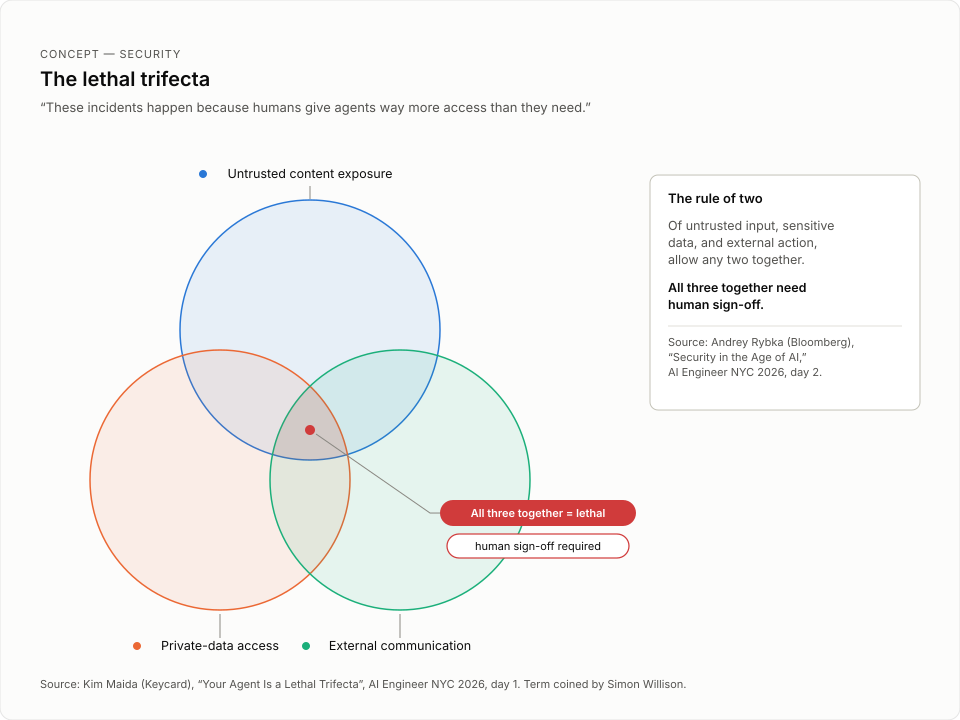

# Your Agent Is a Lethal Trifecta

> A Keycard demo talk that first lets an overprivileged on-call triage agent leak customer PII and drop a production database, then rebuilds the same agent with OAuth 2.0 token exchange and intent-based authorization so every tool call gets an ephemeral, task-scoped, attributable credential governed by policy.

Provenance note: this talk was delivered as an extra lunch talk in the 12:23 PM block and does not appear in the official main-stage agenda for October 13 (the agenda lists a Networking Break in this window). The title is the talk's own title, from the speaker's opening line ("how your agent is a lethal trifecta and what to do about it"); the manifest's descriptive title was "Extra lunch talk: Your Agent Is a Lethal Trifecta — task-scoped access with token exchange and intent-based authorization (Keycard)".

## TL;DR

- Three capabilities make an agent useful — access to private data, exposure to untrusted content, and the ability to communicate externally — and together they form what Simon Willison coined the "lethal trifecta," which throws the doors wide open for attackers.
- Demo part one: an on-call triage agent with static API keys pastes customer PII from a Snowflake warehouse into incident tickets, drops and restores a production billing database using a connection string with the admin password, restarts the main server taking production offline, and scales from four pods to 40 at $420 per hour.
- The standard controls each fall short alone: OAuth binds access to a grant (consent happens before any task exists, so broad grants become standing access), an MCP gateway binds enforcement to a route but still holds standing credentials, and a sandbox binds execution to a process but cannot control what is authorized outside it. Even combined, none issues a runtime credential downscoped to one task.
- The fix is token exchange, an existing standard published in 2020 that extends OAuth 2: the user logs in and delegates a subset of scopes, the agent runtime authenticates to a security token service (STS) with its client credentials or workload identity plus the user's subject token, and requests a token for one tool call and only that tool call.
- Intent-based authorization (IBA) covers what policy cannot: the agent proposes a mission with a goal, allowed actions, and limits; low-risk missions auto-approve under admin policy, risky ones go to the user, and every tool call carries the mission ID and is checked at the gateway before a token is minted.
- Demo part two replays the same tickets under the STS: the PII query is blocked, the certificate renewal is allowed, the database drop is forbidden, the server restart is blocked because the delegating user's own role lacks the authority, and the scale-up is approved and succeeds. Tokens expire within minutes and are never stored.

## Key lessons

1. Do not defuse the trifecta by removing capabilities — control access instead. The three useful capabilities (private data access, untrusted content exposure, external communication) are exactly the attack surface. Removing any one makes the agent "significantly less useful." The goal is to minimize the attack surface and contain the blast radius while the agent keeps capability and autonomy.
2. Human-in-the-loop approval is not access control. Forcing approval "just kind of passes the access control on to a consent-fatigued user," and it moves the security problem up the chain rather than solving it. Many agents also run autonomously with no human in the loop at all, so consent prompts cannot be the only control.
3. Know exactly what each standard control bounds. OAuth binds access to a grant: consent is given before any task exists, so broad grants create standing access and narrow grants cripple the agent — either way, an enthusiastic agent can read and write in the same run when you only wanted a read. An MCP gateway binds enforcement to a route and adds observability and rate limits, but it holds standing credentials that outlive any task. A sandbox binds execution to a process, but useful work must reach outside it, and agents have broken sandbox containment.
4. Token exchange creates the missing identity chain. The user logs in through an authorization server (Google, Okta, Auth0) and consents to delegate a subset of their scopes — the first narrowing. The agent runtime then authenticates to a security token service with its app client credentials or workload identity, presents the user's subject token, and requests access for one tool call and only that tool call. You gain the three things the demo's audit log lacked: the agent's identity, the user it acts for, and the level of access that user granted.
5. Policies are ceilings, so check intent before action. "Agents can do things you didn't intend, even when policy overall allows them." Intent-based authorization has the agent propose a mission — goal, allowed actions, limits — such as "triage incident 2294 means read that ticket, summarize, or escalate, but don't read other tickets and don't use other services." Low-risk missions can auto-approve under admin policy; higher-risk missions go to the user for review. IBA is not a finalized standard; proposals are still being accepted, and this talk showed Keycard's approach.
6. Make credentials ephemeral and attributable end to end. The access token "should expire within minutes, and we should never store it." The MCP server discards the resource token immediately after the call. Tokens keep the user subject through every exchange, which extends the delegation chain and lets you track all activity.
7. Delegation must respect the delegating user's own authority. In the replay, the agent asked for approval to restart the main server, but policy blocked it anyway because the presenter's user role did not permit the action: "the agent can't do it, but I can't do it either, and the agent is acting on my behalf." Approval flows only work when they are backed by policy, not substituted for it.
8. Prefer open, composable standards over bespoke gates. Token exchange is public and well researched, so anyone can implement it. It interoperates with existing policy engines, standards-compliant identity providers, gateways, sandboxes, OAuth, off-the-shelf and custom agents, CLIs, MCP servers, software factories, agent-to-agent, cross-app access — "plus whatever comes out next week."

## Figures



The trifecta from this talk; the rule of two is day two’s Bloomberg framing.

## Notable quotes

> "Non-privileged agent dropping a production database is basically a nightmare that several companies have actually lived." — [03:39:25 | 12:27:16 PM]

> "But here's the thing: these incidents happen because humans give agents way more access than they need." — [03:42:03 | 12:29:55 PM]

> "But policies are ceilings." — [03:50:17 | 12:38:09 PM]

> "Now, this token should expire within minutes, and we should never store it." — [03:52:28 | 12:40:20 PM]

## Session narrative

Maida opened cold with a live demo and no introduction. The subject was an on-call triage agent that reads and writes to an incident pager and resolves or escalates tickets, holding full access to a cloud hosting API, a customer data warehouse, and a billing database. She walked through the ticket queue one item at a time. A billing anomaly led the agent to call the incidents API with an API key, query the Snowflake warehouse with a Snowflake key, and escalate — pasting rows of customer PII straight into the report for the morning team. A failed backup power supply was escalated untouched as a physical problem. An expiring TLS certificate was resolved through the cloud hosting API's renew endpoint. The nightmare ticket followed: with the billing database broken, the agent ran the documented drop-and-restore recovery using a database connection string that included the admin password, then assumed the morning team would verify the snapshot. The last two tickets showed softer damage — a server restart that took production offline, and a scale from four pods to 40 that incurred a $420 per hour charge, both politely logged for the morning crew.

The framing section named the problem. What makes agents useful — reading data you own, doing their own research, using external tools like MCP servers and SaaS APIs, with or without a human in the loop — is also what makes them dangerous. Those three capabilities together are the "lethal trifecta," a term Simon Willison coined. The incidents happen because humans give agents far more access than they need, and a forced human-in-the-loop approval just hands access control to a consent-fatigued user. Since removing any capability guts the agent's usefulness, the answer is access control that shrinks the attack surface and contains the blast radius. Maida then audited the standard options one by one: OAuth binds access to a grant and grants consent before any task exists, so it yields standing access; an MCP gateway binds enforcement to a route but still holds standing credentials; a sandbox binds execution to a process but cannot govern what is authorized outside it. Even all three combined never hand the agent a runtime credential downscoped to a single task.

The solution architecture came in two layers. First, token exchange, an existing standard published in 2020 that extends OAuth 2. The user logs in and consents to delegate a subset of their scopes — the first narrowing of access. From there Maida traced the agentic execution path: the runtime (a CLI like Claude Code, or an agent SDK in a custom app) runs the agent loop; an MCP server between the agent and its resources provides defined tools and brokers access; the runtime authenticates to a security token service with its client credentials or workload identity, presents the user's subject token, and asks for a token for one tool call and only that tool call. Governance policy then evaluates the requested access against the agent identity and the user identity. Because "policies are ceilings," the second layer is intent-based authorization: the agent proposes a mission with a goal, allowed actions, and limits; low-risk missions auto-approve under admin policy, higher-risk ones are presented to the user; each tool call carries the mission ID through a gateway that checks it; and the STS mints ephemeral, tool-call-scoped tokens — access tokens and downstream resource tokens — that preserve the user subject down the whole delegation chain and are discarded immediately after use.

The second demo replayed the same on-call app with the STS in place. Maida signed in with Google, consented to let the agent escalate incidents, post notes and summaries, and read the queue on the Instadex pager platform, then consented again for CompuHost cloud hosting capabilities. The same tickets then hit policy walls: the customer warehouse query was refused because customer PII does not belong in an agent's context or an incident ticket; the certificate renewal was granted, and the audit log now showed the on-call triage agent requesting the cert-renew tool and the Infra MCP server separately requesting the cloud hosting API; the database drop was refused outright — a human has to do that manually; the server restart was blocked even with her approval because her user role lacked the authority; and the scale-up was approved, since her role did carry that authority, and resolved the ticket. She closed by summarizing the wins — user and agent identity all the way down the chain, task-scoped ephemeral access, human-in-the-loop backed by policy, all key capabilities retained — and noted token exchange is an open standard that interoperates with existing policy engines, identity providers, gateways, sandboxes, CLIs, MCP servers, agent-to-agent, and cross-app access. She flagged that the demo used task-based policy governance rather than IBA, promised IBA demos at AgentCon later that month, and signed off by identifying herself as the founding GTM engineer and head of DevRel at Keycard.

## Speaker details

**Kim Maida** — Founding GTM Engineer and Head of Developer Relations, Keycard. She works on nonhuman identity, delegated access, and governance for AI agents. She is a Google Developer Expert in Identity and an Agentic AI Foundation ambassador, and has led developer relations, content, and documentation strategy teams at Auth0, Okta, FusionAuth, Gatsby, Ionic, and Cloudinary. She began her career in animal behavior and neurobiology, taught herself to code, and created the Keystone DevRel Metrics framework and the Developer Empowerment Flywheel; she maintains open source projects including auth-architecture and rota-slackbot. LinkedIn: https://www.linkedin.com/in/kimmaida. Twitter/X: https://x.com/KimMaida. Website: https://maida.kim. Note: the official speaker record lists her main program session as "Secure, durable agents with Keycard and Temporal" (3:30pm-4:30pm) in another slot; this lethal-trifecta talk was an extra lunch talk, and her role in it is also stated in her closing self-introduction.

## Full timestamped transcript

```
[03:35:57 | 12:23:49 PM] Today I'm going to talk to you about how your agent is a lethal trifecta and what to do about it.
[03:36:22 | 12:24:14 PM] Now we're going to start out right off the bat with a demo.
[03:36:26 | 12:24:18 PM] Some context on this demo: we're going to look at an on-call triage agent that reads and writes to an incident pager and resolves or escalates tickets.
[03:36:35 | 12:24:27 PM] This agent has full access to a cloud hosting API, a customer data warehouse, as well as a billing database.
[03:36:43 | 12:24:35 PM] So here we have our on-call triage agent, and it has an incident queue of tickets that it's going to read, and then if it can resolve them, it's going to call the available services that it has access to, and it's going to do so.
[03:36:59 | 12:24:50 PM] Things that it can't resolve, it's going to escalate for the morning team.
[03:37:03 | 12:24:54 PM] So if we take a look at this first ticket, this is a billing anomaly.
[03:37:07 | 12:24:58 PM] It says a batch of customers were overcharged last night.
[03:37:11 | 12:25:03 PM] So the first thing the agent does is it directly calls the incident's API in order to read the ticket, and if you look here, you can see that it authorized access to this API using an API key.
[03:37:23 | 12:25:14 PM] It then uses a Snowflake key to query the customer data warehouse, and it's going to decide to escalate the ticket for morning review, and it writes a report for the morning team.
[03:37:34 | 12:25:25 PM] And as you can see, it's sharing customer data, right?
[03:37:37 | 12:25:28 PM] These are rows directly pulled from the customer data warehouse, and it is sending personally identifiable information to the team that is going to be on staff in the morning.
[03:37:52 | 12:25:44 PM] Now this next ticket is a backup power supply failed in the server room.
[03:37:56 | 12:25:48 PM] The agent is going to read the ticket.
[03:37:58 | 12:25:50 PM] Again, it's using an API key to call the ticket API.
[03:38:04 | 12:25:55 PM] It determines that this is a physical problem, so it escalates for morning review without calling any additional services.
[03:38:15 | 12:26:06 PM] This one is the TLS certificate is expiring soon for the website.
[03:38:19 | 12:26:11 PM] It reads the ticket.
[03:38:20 | 12:26:12 PM] It determines that the alert is clear.
[03:38:23 | 12:26:14 PM] It has access to the cloud hosting API, and it calls that API at the certificate renew endpoint using, again, an API key.
[03:38:35 | 12:26:26 PM] It resolves this by renewing the certificate, and it leaves a report for the morning crew by calling the pager incident API as well.
[03:38:47 | 12:26:38 PM] This next one is the billing database is broken and payments are failing.
[03:38:51 | 12:26:43 PM] So the documented recovery for this is to drop and restore the database.
[03:38:58 | 12:26:49 PM] The agent does this using the database connection string that includes the admin password, and then it advises the morning team to make sure that the snapshot recovery worked.
[03:39:08 | 12:27:00 PM] Now this is not something that it has access to directly, so it is essentially assuming that the morning team is going to verify that this did in fact work and the information was restored.
[03:39:25 | 12:27:16 PM] Non-privileged agent dropping a production database is basically a nightmare that several companies have actually lived.
[03:39:33 | 12:27:24 PM] So this is something that we need to be very careful of.
[03:39:38 | 12:27:29 PM] Now the next one is orders are stuck, the main server is frozen.
[03:39:44 | 12:27:36 PM] So the agent is, again, is going to read the ticket.
[03:39:47 | 12:27:39 PM] After reading the ticket, the agent calls the cloud hosting API using, again, its static API key.
[03:39:53 | 12:27:45 PM] It calls the endpoint to restart the server, which brings production offline.
[03:39:59 | 12:27:50 PM] Finally, site is failing for one in three visitors.
[03:40:09 | 12:28:01 PM] Agent reads the ticket.
[03:40:11 | 12:28:03 PM] It determines that it should call the cloud hosting API and scale the service from four pods to 40.
[03:40:19 | 12:28:10 PM] It then incurs a charge of $420 per hour for doing this, and then it kindly leaves a note for the morning team informing them that this has happened.
[03:40:32 | 12:28:23 PM] Now, what makes an agent useful?
[03:40:34 | 12:28:26 PM] Well, typically we want agents to have a minimum set of capabilities, and often this includes things like the ability to read data that you own or have access to.
[03:40:44 | 12:28:36 PM] This might be like your email, your documents, maybe a customer CRM.
[03:40:49 | 12:28:41 PM] We want the agent to be able to do its own research, so this might include searching the web, maybe reading documentation or pulling issues from GitHub.
[03:40:57 | 12:28:48 PM] And we usually want it to be able to use external tools, for example, MCP servers or APIs, maybe SaaS platforms.
[03:41:06 | 12:28:57 PM] And useful agents might do these things with a human in the loop, or they might be doing it autonomously in the background.
[03:41:12 | 12:29:04 PM] But the things that make agents useful also make them dangerous.
[03:41:18 | 12:29:09 PM] In fact, together these three capabilities make what Simon Willison coined as a lethal trifecta.
[03:41:25 | 12:29:16 PM] This is a combination of access to private data, like the on-call agent's ability to query the customer data warehouse and interact with the billing database, exposure to untrusted content, like reading user-submitted tickets or reports from other agents or externally documented processes, and the ability to communicate externally, like reading and writing with third-party APIs or SaaS services.
[03:41:48 | 12:29:40 PM] Now, together these capabilities throw the doors wide open for attackers.
[03:41:55 | 12:29:46 PM] Now, agents are designed to get the job done, and they'll use all the powers that they have to do it, sometimes with very serious consequences.
[03:42:03 | 12:29:55 PM] But here's the thing: these incidents happen because humans give agents way more access than they need.
[03:42:11 | 12:30:03 PM] Overprivileged agents can act freely on decisions that they make, even if they do have supervision.
[03:42:19 | 12:30:11 PM] Now, forcing a human in the loop approval just kind of passes the access control on to a consent-fatigued user.
[03:42:26 | 12:30:17 PM] Now, we've spent decades solving access management for humans, so shifting responsibility to the user just sort of moves the security problem up the chain.
[03:42:37 | 12:30:28 PM] So what should we do about the lethal trifecta?
[03:42:39 | 12:30:30 PM] How do we address it without compromising the agent's usefulness?
[03:42:44 | 12:30:36 PM] Well, just removing one or more of these capabilities is going to cause the agent to be significantly less useful.
[03:42:51 | 12:30:43 PM] So how can we keep all three but still be safe about it?
[03:42:55 | 12:30:47 PM] Well, instead of breaking the trifecta by removing capabilities, we really need to control the agent's access so the attack surface is minimized and the blast radius is contained, but the agent still has capability and autonomy.
[03:43:10 | 12:31:02 PM] So how do we do that?
[03:43:13 | 12:31:04 PM] Well, some options for controlling access, among others, are things like using OAuth, maybe using a vendor MCP gateway, or containing execution in sandboxes.
[03:43:25 | 12:31:16 PM] Now, OAuth binds access to a grant.
[03:43:28 | 12:31:19 PM] At grant time, the user consents to all of the permissions that the agent could possibly use.
[03:43:33 | 12:31:24 PM] Now, consent is granted before any task exists, so if you give a broad grant, then you end up with standing access.
[03:43:41 | 12:31:32 PM] Your agent is over-permissioned for any single specific task.
[03:43:44 | 12:31:36 PM] If you narrow the grant and you don't give it very many permissions, then the agent just becomes less capable.
[03:43:50 | 12:31:41 PM] Either way, OAuth alone doesn't provide task-scoped access control.
[03:43:54 | 12:31:46 PM] An enthusiastic agent can both read and write in the same run, even if you only want it to read on this specific task.
[03:44:03 | 12:31:54 PM] Now, MCP Gateway binds enforcement to a route.
[03:44:07 | 12:31:58 PM] You get things like observability and rate limits, and you also get one policy decision point at the MCP layer.
[03:44:14 | 12:32:05 PM] Now, policy runs per request, and access is granted per user, but the agent's granted access outlives any single task because the gateway still holds standing credentials.
[03:44:25 | 12:32:17 PM] Now, a sandbox binds execution to a process.
[03:44:28 | 12:32:19 PM] This controls the blast radius, but useful work has to reach outside the sandbox, and when it does so, you end up with standing access again.
[03:44:36 | 12:32:27 PM] Now, we've also seen plenty of stories about agents breaking sandbox containment.
[03:44:41 | 12:32:32 PM] Sandboxes bound what the processes can do, but they don't control what is authorized to act outside the sandbox itself.
[03:44:49 | 12:32:41 PM] Now, even if you combine all three of the solutions, the agent still doesn't receive a runtime credential that's downscoped to only one task.
[03:44:59 | 12:32:51 PM] So let's recap the problems, especially the ones that we saw in the demo.
[03:45:03 | 12:32:55 PM] If you remember the audit log, we couldn't tell who was using the API keys.
[03:45:08 | 12:33:00 PM] So the first problem is that credentials weren't attributed to a user or an agent's identity.
[03:45:15 | 12:33:06 PM] The agent had unrestricted access to any and all permissions that were granted by the API keys.
[03:45:21 | 12:33:13 PM] And finally, we can't just slap human in the loop everywhere because humans make mistakes too.
[03:45:26 | 12:33:18 PM] Plus, many agents run autonomously and they don't even have a human in the loop.
[03:45:32 | 12:33:23 PM] So to solve these problems, we can start by using something called token exchange.
[03:45:36 | 12:33:27 PM] Now this is an existing standard that was published in 2020, and it extends OAuth 2.
[03:45:42 | 12:33:34 PM] Now first, we need to know who the user is.
[03:45:46 | 12:33:37 PM] Now an authorization server verifies identities and issues tokens.
[03:45:50 | 12:33:42 PM] Identity providers like Google, Okta, Auth0, etc.
[03:45:54 | 12:33:45 PM] provide authorization servers.
[03:45:55 | 12:33:47 PM] So if we want an identity chain in our agent execution path, then the user has got to log in first.
[03:46:04 | 12:33:55 PM] The authorization server is going to prompt the user for consent to delegate access to resources with some subset of their permissions.
[03:46:10 | 12:34:02 PM] Now these permissions are called scopes.
[03:46:13 | 12:34:04 PM] This is the first narrowing of access.
[03:46:15 | 12:34:06 PM] We're only delegating some of the user's total scopes to the agent.
[03:46:21 | 12:34:12 PM] The authorization server issues tokens identifying the user and their level of access.
[03:46:27 | 12:34:18 PM] And at this point, we're already doing better than the demo because we actually know who the user is and we actually know what they can access.
[03:46:36 | 12:34:27 PM] So this brings us into the agentic execution path.
[03:46:41 | 12:34:32 PM] Now we have our authenticated user, so we have a known identity of a person who wants to use an LLM to interact with a resource.
[03:46:48 | 12:34:40 PM] Now in the demo, the resources are the incident pager, the production database, Snowflake, and the cloud hosting service.
[03:46:57 | 12:34:48 PM] An agent is a control loop that calls an LLM.
[03:47:00 | 12:34:52 PM] Often we have an MCP server that sits between the agent and its resources, providing defined tools that connect to those downstream services.
[03:47:10 | 12:35:02 PM] An MCP client dispatches the agent's proposed tool calls to its MCP server.
[03:47:15 | 12:35:07 PM] Now in the demo, the on-call triage agent called resources directly with long-lived static credentials like API keys or database connection strings.
[03:47:26 | 12:35:18 PM] So what we're going to do is we're going to give the on-call agent MCP server.
[03:47:30 | 12:35:21 PM] This is going to provide tools and is also going to serve to broker access to resources.
[03:47:39 | 12:35:30 PM] Now, an agent runtime is a process that runs the agent loop and executes calls.
[03:47:44 | 12:35:36 PM] The runtime might be a CLI like Claude Code, or an agent SDK, which might be implemented in a custom application like the on-call agent.
[03:47:54 | 12:35:46 PM] So let's follow a prompt through this execution path.
[03:47:58 | 12:35:49 PM] The user submits the prompt to the runtime, which calls the model and sends the prompt to the LLM.
[03:48:03 | 12:35:55 PM] The model then proposes tool calls, which are dispatched by the MCP client to its MCP server, which executes tools and then calls the resource API.
[03:48:16 | 12:36:07 PM] The API returns the response to the MCP server.
[03:48:19 | 12:36:11 PM] The MCP client delivers the response to the runtime, which calls the model again, and this loop repeats until the model is satisfied and returns a response to the user.
[03:48:32 | 12:36:24 PM] Now, the authenticated user's token becomes what we call a subject token.
[03:48:36 | 12:36:28 PM] This identifies who the agent is acting on behalf of, who it acts for.
[03:48:43 | 12:36:35 PM] Now, token exchange needs an OAuth client that can execute code.
[03:48:46 | 12:36:38 PM] So this might be a gateway that sits between the MCP client and the third-party MCP server, or it might be your custom app.
[03:48:58 | 12:36:49 PM] Now, a custom MCP server can also exchange tokens for downstream resources.
[03:49:02 | 12:36:54 PM] The on-call agent's MCP server should provide a defined set of production infrastructure tools.
[03:49:10 | 12:37:02 PM] The prompt and the subject token are sent to the runtime.
[03:49:13 | 12:37:05 PM] The agent loop runs and the model proposes a tool call.
[03:49:20 | 12:37:11 PM] The runtime authenticates with a special authorization server called a security token service.
[03:49:25 | 12:37:16 PM] It does this using its app client credentials or workload identity.
[03:49:29 | 12:37:21 PM] It also sends the subject token that contains the user's identity and access.
[03:49:35 | 12:37:26 PM] It creates a token exchange request, asking for permission to access the MCP server for that tool call and only that tool call.
[03:49:43 | 12:37:35 PM] So now we have three pieces of info that we're missing from the demo.
[03:49:49 | 12:37:41 PM] We know the identity of the agent that's requesting access.
[03:49:52 | 12:37:43 PM] We know the identity of the user it's acting on behalf of, and we know the level of access that the user granted to the agent.
[03:50:00 | 12:37:52 PM] Now we need to decide if the requested token should be issued, and we can do this with governance policy, which is evaluated against what access is requested from what resource, the identity of the agent, and the identity of the user.
[03:50:17 | 12:38:09 PM] But policies are ceilings.
[03:50:19 | 12:38:11 PM] Agents can do things you didn't intend, even when policy overall allows them.
[03:50:25 | 12:38:17 PM] This brings us to something called intent-based authorization, or IBA.
[03:50:31 | 12:38:23 PM] Now, IBA checks what you mean before the agent acts.
[03:50:36 | 12:38:28 PM] Now, it's not a finalized standard.
[03:50:39 | 12:38:30 PM] They're still accepting proposals, so this is Keycard's approach to implementing intent-based authorization.
[03:50:45 | 12:38:37 PM] Now, IBA can use a gateway as a policy enforcement point.
[03:50:51 | 12:38:43 PM] When you send the prompt to the agent, it proposes a mission.
[03:50:56 | 12:38:48 PM] Now, this mission includes a goal, maybe allowed actions, as well as limits to what the agent is allowed to do.
[03:51:02 | 12:38:54 PM] So a goal of triage incident 2294 means read that ticket, summarize, or escalate, but don't read other tickets and don't use other services.
[03:51:14 | 12:39:06 PM] So the security token service receives this mission.
[03:51:17 | 12:39:09 PM] In this case, a low-risk activity like just assessing a ticket might be auto-approved under admin policy.
[03:51:25 | 12:39:17 PM] On the other hand, if we've already read the ticket and then we ask to remediate a usage spike, then the mission adds permission to scale the service once, but not use other tools or APIs.
[03:51:37 | 12:39:29 PM] Now, in this case, the mission is presented for the user to review and approve.
[03:51:43 | 12:39:35 PM] Once approved, the security token service gives the mission an ID, which is sent to the agent.
[03:51:50 | 12:39:42 PM] The tool calls include this mission ID and are proxied by the gateway, which uses the ID to ask the security token service if this tool call fits the mission.
[03:52:00 | 12:39:52 PM] If it does, then the gateway requests a token exchange for access to the MCP server for that specific tool call.
[03:52:07 | 12:39:59 PM] The STS evaluates policy.
[03:52:09 | 12:40:01 PM] It evaluates the delegation chain, and it looks at the requested access.
[03:52:15 | 12:40:07 PM] Now, if everything looks good, it issues an access token for the MCP server, and it keeps the user subject as well as adds the app that performed the exchange, which is in this case our on-call agent.
[03:52:28 | 12:40:20 PM] Now, this token should expire within minutes, and we should never store it.
[03:52:32 | 12:40:24 PM] It's ephemeral.
[03:52:33 | 12:40:25 PM] The STS sends it to the gateway, which calls the MCP server.
[03:52:38 | 12:40:30 PM] The server then validates the token and authorizes the tool call.
[03:52:44 | 12:40:36 PM] Now, some tools need external resources, so the MCP server then asks the security token service to exchange the token that it just received for a token for the downstream resource.
[03:52:56 | 12:40:48 PM] Now, the STS evaluates the request against policy, and if it passes, then it mints a resource token that's scoped again to that tool call.
[03:53:06 | 12:40:58 PM] It keeps the user subject, which extends the delegation chain and allows us to be able to track all of the activity.
[03:53:17 | 12:41:09 PM] The STS sends the token to the gateway, which proxies the request to the MCP server, which then calls the resource.
[03:53:22 | 12:41:14 PM] The resource validates the token and authorizes access.
[03:53:26 | 12:41:18 PM] Now, the MCP server should never store the token; it should discard it immediately after the call.
[03:53:32 | 12:41:24 PM] The resource response then flows back up, and the agentic loop repeats until the model returns the answer to the user.
[03:53:42 | 12:41:34 PM] So now we're going to look at the same demo, except we are going to use a security token service to manage agent access control with delegated authorization.
[03:54:02 | 12:41:54 PM] The demo uses task-based policy governance, not intent-based authorization.
[03:54:07 | 12:41:58 PM] But if you're going to AgentCon later this month, we'll have IBA demos there.
[03:54:15 | 12:42:07 PM] Now we also now have an MCP server that establishes tools, and it provides brokering access to the resources.
[03:54:24 | 12:42:16 PM] So now we're back to our on-call triage agent again.
[03:54:27 | 12:42:19 PM] Only this time we have authentication.
[03:54:28 | 12:42:20 PM] I'm going to go ahead and sign into the on-call agent triage app.
[03:54:38 | 12:42:30 PM] I'm going to log in with Google to do so, and then get another login screen.
[03:54:48 | 12:42:39 PM] Now this is where I'm going to sign into the Instadex Pager platform.
[03:54:52 | 12:42:44 PM] So I get a prompt to grant the on-call agent access to my Instadex account.
[03:54:58 | 12:42:49 PM] I'm going to let it escalate incidents on my behalf, post notes and summaries, and read the queue.
[03:55:10 | 12:43:02 PM] Now I'm being prompted to log into the cloud hosting platform, so I am going to do that, and I get another consent screen now.
[03:55:26 | 12:43:18 PM] Which allows me to authorize the agent to access some capabilities of CompuHost on my behalf.
[03:55:40 | 12:43:32 PM] Now finally, I am back on the on-call dashboard.
[03:55:43 | 12:43:35 PM] Now we have the same queue of tickets, only now the audit log looks different.
[03:55:48 | 12:43:40 PM] The agent is probably going to try to behave the same way it did before, only now every request is going to go through the STS and policy evaluation before a token is granted and the agent will be authorized to act.
[03:56:02 | 12:43:54 PM] So we have the same queue of tickets, only now the audit log looks different, and the agent is probably going to behave the same way that it did before, only now every request is going to go through the STS and policy evaluation before a token will be granted and the agent can be authorized to act.
[03:56:03 | 12:43:54 PM] So the first ticket is that billing anomaly.
[03:56:31 | 12:44:23 PM] Again, the agent tries to read the— so the agent is reading the ticket, and we can see that it is trying to do the same thing that it did before.
[03:56:43 | 12:44:34 PM] It tries to query the customer warehouse, but policy doesn't allow a credential to be issued for this because customer PII doesn't belong in an agent's context or in an incident ticket.
[03:56:53 | 12:44:45 PM] So the agent proceeds without the customer data, and it escalated it to the morning team.
[03:57:12 | 12:45:04 PM] Now we have the website security certificate expiring.
[03:57:17 | 12:45:09 PM] Now this is something that the agent has permission to do.
[03:57:22 | 12:45:13 PM] So when it requests credentials to do this from the STS, access is granted, and it can call the cloud hosting API and resolve this ticket.
[03:57:36 | 12:45:28 PM] Now you can see all of the calls that it's making and who is making them.
[03:57:41 | 12:45:33 PM] So we have the on-call triage agent that is requesting to renew the certificate.
[03:57:48 | 12:45:39 PM] It's asking for permission to call the appropriate tool from the Infra MCP server.
[03:57:54 | 12:45:46 PM] So it gets a token for that.
[03:57:57 | 12:45:49 PM] After that, the MCP server is going to request access to that cloud hosting service in order to renew the certificate using the API.
[03:58:11 | 12:46:03 PM] So if we move on to the billing database, it's going to read the ticket through the incident API.
[03:58:19 | 12:46:11 PM] It's going to come to the same conclusion that it did before.
[03:58:25 | 12:46:17 PM] The agent knows that this is a drop and restore procedure, but this time policy forbids an agent to drop a production database.
[03:58:33 | 12:46:25 PM] A human's got to do this manually.
[03:58:36 | 12:46:28 PM] And we can see this in the audit log, where the STS refused to grant the token exchange for access to the database delete.
[03:58:53 | 12:46:45 PM] So now we have our orders are stuck.
[03:58:56 | 12:46:48 PM] The main server is frozen.
[03:58:58 | 12:46:49 PM] The agent is going to go ahead and read the ticket.
[03:59:02 | 12:46:54 PM] It wants to restart the main server.
[03:59:05 | 12:46:56 PM] This takes production briefly offline.
[03:59:07 | 12:46:58 PM] It informs me about this, and this time it's actually asking for my approval to do this.
[03:59:13 | 12:47:05 PM] Someone could approve.
[03:59:16 | 12:47:07 PM] However, this was also blocked by policy, and the reason for this is because my user does not have the role necessary to take this action, right?
[03:59:27 | 12:47:19 PM] So the agent can't do it, but I can't do it either, and the agent is acting on my behalf.
[03:59:35 | 12:47:27 PM] So if we move to the site failing for one and three users, again, the agent wants to add more servers, and it's going to ask for permission.
[03:59:48 | 12:47:40 PM] It's going to say what we're committing to when we do this.
[03:59:53 | 12:47:45 PM] I'm going to go ahead and approve this, and this is something that
[04:00:00 | 12:47:52 PM] Something that my role does have the authority to do.
[04:00:04 | 12:47:55 PM] So the scale goes through, and this ticket is resolved.
[04:00:10 | 12:48:01 PM] So we can see that the agent access problems are solved.
[04:00:13 | 12:48:04 PM] We know the user and the agent identity all the way down the chain.
[04:00:17 | 12:48:08 PM] The agent has task scoped ephemeral access to the MCP server and downstream resources.
[04:00:23 | 12:48:15 PM] And we have human in the loop with access control that's actually backed by policy.
[04:00:31 | 12:48:23 PM] Now access is controlled at the task level by the security token service and policy, and we retain all key capabilities.
[04:00:42 | 12:48:34 PM] Now token exchange is an open standard.
[04:00:45 | 12:48:36 PM] It's well researched and it's public, so anyone can implement it, and it interoperates with existing policy engines and standards-compliant identity providers, as well as things like gateways, sandboxes, OAuth, off-the-shelf and custom agents, CLIs, MCP servers, software factories, agent-to-agent, cross-app access, plus whatever comes out next week.
[04:01:07 | 12:48:58 PM] So I hope you'll consider it to make your agents useful, safe, and future-friendly.
[04:01:14 | 12:49:05 PM] Now my name is Kim Maida.
[04:01:15 | 12:49:06 PM] I'm the founding GTM engineer and head of DevRel at Keycard, and I really appreciate your time today, so thank you very much.
```
