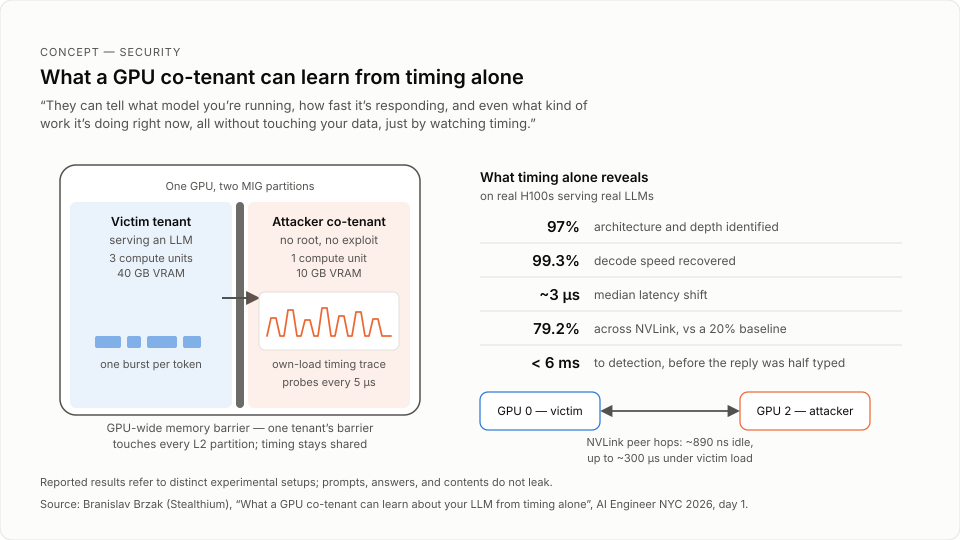

# Extra lunch talk: what a GPU co-tenant can learn about your LLM from timing alone (MIG and NVLink side channels)

> Branislav Brzak demonstrates how timing on shared GPUs can reveal model and workload information without reading another tenant’s memory. Reported results refer to distinct experimental setups.

## TL;DR
- A co-tenant on a MIG-partitioned NVIDIA GPU can identify your model's architecture and depth at 97% accuracy and its decode speed at 99.3% accuracy, on real H100s serving real LLMs. The attacker needs no root access and no exploit, and never reads the victim's memory.
- The leak is the GPU-wide memory barrier: it takes effect in every L2 partition even though MIG partitions compute units, VRAM, bandwidth, and L2 cache. The attacker times its own loads every five microseconds and watches a median latency shift of about three microseconds.
- Layer counts are the sharp identifier. A fold-and-average method, under 30 lines of code with no training data, lands on near-integer counts (mean distance 0.028 from an integer across 22 traces) and also identifies unreleased models and fine-tunes or distillations that share a base model.
- The same attack works across NVLink without a shared die: on an 8x H100 NVSwitch server, a probe on GPU 2 timed peer-access hops to GPU 0 memory (about 890 nanoseconds idle, up to about 300 microseconds busy) and fingerprinted five models at 79.2% accuracy against a 20% baseline.
- What does not leak: actual prompts, answers, or contents. Only timing metadata leaks.
- Detection is possible: the probing pattern (one kernel relaunched about 3,000 times against the same 40 kilobytes, with only one kilobyte returned to the CPU) was caught before the victim's response was half typed.

## Key lessons
1. MIG isolates hardware, but not time. Compute units, VRAM capacity, bandwidth quotas, and L2 cache partitions are per instance, with no cross-instance L2 eviction. But GPU-wide memory barriers still touch every L2 partition on the card, so when one tenant is busy, other tenants' reads get slightly slower. Timing is the one shared resource.
2. The attack primitive is minimal and unprivileged: no root, no exploit. The attacker only reads its own small buffer, times each load, and repeats every five microseconds. The observable effect is a median latency increase of only about three microseconds — invisible to the naked eye, sufficient for the attacker. The MIG memory-barrier leak itself is credited to the USENIX Security '26 "Behind Bars" researchers, not the speaker.
3. The speaker’s headline claims for the demonstrated H100 setups: model architecture and depth at 97% accuracy; decode speed at 99.3% accuracy; busy periods, token counts, and answer length recoverable; workload type (code, JSON, retrieval) classifiable. Prompts, answers, and contents are not recoverable — the channel is timing only.
4. Speed alone is not a fingerprint; layer counts are. Qwen3 8B and Llama 3 8B decode only 1.6% apart in token rate, so token rate narrows but does not identify. Folding and averaging the trace once per model yields a count that lands almost exactly on a whole number (mean distance from an integer 0.028 across 22 traces), equal to the model's layer count plus one to three additional peaks.
5. The layer-count classifier is deliberately simple: under 30 lines of code, no training set, no labels, no configuration. It tests each candidate depth from 16 to 48, measures how strongly that depth's expected signature appears in the trace, and picks the best fit. For Qwen3 8B, 36 layers won clearly, four times over the next candidate. Because it is a best-fit test rather than a lookup, it also identifies proprietary or unreleased models, and fine-tunes and distillations that share a base model: Llama 3 8B, Llama 3.1 8B, and the DeepSeek R1 distill all share the 32-layer backbone, with per-layer timing within about 1.6 nanoseconds median shift, yet remain separable.
6. Workload-type classification rides on speculative decoding. With speculative decoding enabled (an opt-in in vLLM, not the default), text predictability changes how many drafted tokens are accepted per step, which changes step time. Of 40 half-second workload votes (prose, code, JSON, retrieval), 31 were right, and four full responses were identified by majority vote. Across 11 configurations (dense and mixture of experts, BF16 and FP8), the signal always appeared — 70.2% spread on GPT-OSS 20B versus 0.9% on GLM 4 9B — and prose was fastest in 11 runs where chance gives one in four.
7. The NVLink variant does not need the same die. On an 8x H100 server over an NVSwitch fabric, the victim ran tensor parallelism across GPUs 0 and 1 while the attacker probed from GPU 2, timing peer-access hops to memory physically on GPU 0 (peer access is an intended feature, not an abused bug). Idle hops took about 890 nanoseconds; under victim load they climbed to about 300 microseconds, and tokens became countable by eye. NVLink loses the layer bits — they fall below the noise at that distance — leaving mostly tempo: 79.2% accuracy across five identical serving setups against a 20% baseline, with tempo-similar pairs (Llama 3 8B and the R1 distill, both 8B with close decode rates) blurring where MIG layer counts would separate them. Worse signal-to-noise ratio is not safety.
8. Defenses, in the speaker's three takeaways: first, placement — operators control it, so do not place an untrusted tenant's MIG slices next to a sensitive model. Second, know the trade-off — MIG rules out peer-to-peer communication, so there is no tensor parallelism on MIG; sharding over NVLink instead limits what leaks to timing without layer counts. Third, watch the GPU itself — the host infrastructure should actively verify no malicious workloads run. The detection signature: one kernel relaunched about 3,000 times hitting the exact same 40 kilobytes instead of moving to new data, and only one kilobyte sent back to the CPU, because the timing itself was the payload; the alert fired in under six milliseconds of elapsed attack behavior, before the response was half typed.

## Figures



The MIG and NVLink timing leaks demonstrated in this talk.

## Notable quotes
- [04:02:00 | 12:49:51 PM] "They can tell what model you're running, how fast it's responding, and even what kind of work it's doing right now, all without touching your data, just by watching timing."
- [04:07:55 | 12:55:46 PM] "To be clear, this is not a trained machine learning classifier."
- [04:13:04 | 1:00:55 PM] "But worse signal-to-noise ratio isn't the same as safety."
- [04:13:38 | 1:01:29 PM] "Only one kilobyte of data was sent back to the CPU the entire time because the timing itself was the payload, not the output."

## Session narrative
Branislav Brzak opened by naming the threat directly: if you run an LLM in the cloud on a GPU shared with other tenants, the tenant next to you can learn what model you run, how fast it responds, and what kind of work it is doing — without touching your data, only by watching timing. He introduced himself as an AI security researcher at Celtium (an automatic-transcription rendering; the enriched speaker record spells the company Stealthium) focused on low-level GPU security, and stressed how cheap the attack is: no root permissions, no traditional exploit, only timing of hardware that remains shared. A demonstration video set the scene with two dashboards — a Qwen3 model doing inference on the left, an attacker on the right reading the side channel and naming the model and its current output type in real time.

The core argument walked through NVIDIA's multi-instance GPU isolation and its one gap. MIG gives each slice its own compute units and dedicated VRAM; L2 is partitioned per instance with no cross-instance eviction. What stays shared is the GPU-wide memory barrier, which touches every L2 partition on the card. The attacker primitive — credited to the USENIX Security '26 "Behind Bars" researchers — reads only its own small buffer and times each load every five microseconds. The visible effect is about three microseconds of median latency, but that is enough: from a live Qwen3 8B trace, the speaker recovered a fundamental at 881 hertz (tokens per second plus harmonics), then built the sharper identifier — layer counts. Fold-and-average per model yields near-integer counts (mean distance 0.028 from an integer across 22 traces), each equal to the model's depth plus one to three extra peaks. The classifier is under 30 lines of code with no training set or labels; it tests candidate depths from 16 to 48 and picks the best fit, so it also names models it has never seen — including proprietary or unreleased ones — and separates fine-tunes and distillations that share a base model, such as the 32-layer Llama 3, Llama 3.1, and DeepSeek R1 distill 8B family, whose per-layer timing sits within about 1.6 nanoseconds.

He then asked a deeper question on the same channel: not which model, but what it is doing right now. With speculative decoding enabled (an opt-in in vLLM), how predictable the text is changes how many drafted tokens get accepted, which changes step time — and that is the signal. Of 40 half-second workload votes across prose, code, JSON, and retrieval, 31 were right, and four full responses were identified by majority vote. The effect held across 11 configurations, dense and mixture of experts, BF16 and FP8, at very different strengths: 70.2% spread on GPT-OSS 20B versus 0.9% on GLM 4 9B. Next he removed the shared die entirely: on an 8x H100 NVSwitch server, a probe on GPU 2 timed peer-access hops to memory physically on GPU 0 while the victim ran tensor parallelism across GPUs 0 and 1. Idle hops took about 890 nanoseconds; under load they climbed to about 300 microseconds, and tokens became countable by eye. NVLink drops the layer bits below the noise, leaving mostly tempo — 79.2% accuracy across five models against a 20% baseline — and he was explicit that the worse signal-to-noise ratio is not the same as safety.

He closed with detection and defense. His company's product flagged the attack "straight out of the box": a single kernel relaunched about 3,000 times hitting the exact same 40 kilobytes of memory, with only one kilobyte sent back to the CPU, because the timing itself was the payload; the alert fired before the response was half typed. His three takeaways for operators: control placement so untrusted MIG slices do not sit next to sensitive models; know the trade-off, since MIG rules out peer-to-peer communication (no tensor parallelism) while NVLink sharding limits leaks to timing without layer counts; and watch the GPU itself so the host infrastructure actively verifies no malicious workloads run. He thanked the "Behind Bars" researchers again — the whole talk builds on their work — noted that most organizations still lack this visibility, and signed off. This session was an extra lunch talk streamed during the agenda's 12:15–2:05pm networking break, which is why it has no official agenda entry.

## Speaker details
**Branislav Brzak** - AI Security Researcher, Stealthium. Member of the Stealthium Core Team, focused on low-level GPU security research, Linux kernel work, virtualization, and performance engineering. He is the author of the Stealthium research post "Return of a Nosy Neighbor: More Detail, More Noise" (September 2026), which extends the USENIX Security '26 "Behind Bars" work on NVIDIA MIG; this lunch talk presented that research. Based in Serbia. LinkedIn: https://rs.linkedin.com/in/branislav-brzak

(Note: the stream's automatic transcription renders his employer as "Celtium" and once as "Celty"; the enriched speaker record and its sources spell it Stealthium. His self-introduction in the session: "I'm Branislav Brzak, AI security researcher employed at Celtium. At Celtium, we specialize in securing and providing observability into the environments AI systems run on.")


Measurement context: the headline percentages, layer recovery, workload classification, and NVLink model identification are separate measurements. They are not one general attack success rate. The demonstration does not recover prompt or answer text. The [official reading edition](https://aie-nyc-2026-talks.swyxio.workers.dev/talks/branislav-brzak-gpu-neighbor) separates the experiments and their limits.

## Full timestamped transcript
```
[04:01:45 | 12:49:36 PM] Hello everyone.
[04:01:49 | 12:49:40 PM] This talk is about the danger of your LLMs information leak in through shared GPU hardware.
[04:01:54 | 12:49:45 PM] If you're running a model in the cloud on a GPU shared with other tenants, someone next to you can learn things about it.
[04:02:00 | 12:49:51 PM] They can tell what model you're running, how fast it's responding, and even what kind of work it's doing right now, all without touching your data, just by watching timing.
[04:02:08 | 12:50:00 PM] That's what this talk covers: what a co-tenant on the same hardware can learn about your LLM from timing alone and what you can do about it.
[04:02:17 | 12:50:08 PM] To start, I'm Branislav Brzak, AI security researcher employed at Celtium.
[04:02:22 | 12:50:13 PM] At Celtium, we specialize in securing and providing observability into the environments AI systems run on.
[04:02:28 | 12:50:19 PM] My area of focus is low-level GPU-related security research.
[04:02:32 | 12:50:23 PM] That's something this talk covers.
[04:02:35 | 12:50:26 PM] When you share a GPU between tenants, you would expect full isolation, but the isolation provided may not prove to be sufficient.
[04:02:42 | 12:50:34 PM] In the case of this attack, the attacker doesn't even need any special permissions like root access.
[04:02:47 | 12:50:39 PM] It doesn't need any traditional exploit either.
[04:02:49 | 12:50:41 PM] The only thing it does is time the parts of the hardware that are still shared among tenants.
[04:02:56 | 12:50:47 PM] This is a demonstration video of what the victims and the attacker's dashboards look like.
[04:03:01 | 12:50:52 PM] On the left, we have Qwen3 model doing inference.
[04:03:04 | 12:50:56 PM] On the right, the attacker uses a side channel that Qwen3 leaks into as it's running.
[04:03:09 | 12:51:01 PM] From that, it determines exactly what model it is and what kind of text it's producing right now.
[04:03:17 | 12:51:08 PM] These are just the headline claims, but not the whole story.
[04:03:20 | 12:51:11 PM] We can tell which model it is, architecture and depth, within 97% accuracy.
[04:03:25 | 12:51:16 PM] We can tell how fast is the coding within 99.
[04:03:28 | 12:51:20 PM] 3% accuracy.
[04:03:29 | 12:51:21 PM] We can tell when and how much, the busy periods, token counts, and the answer length.
[04:03:35 | 12:51:26 PM] We can tell what kind of work it's doing: code, JSON, or retrieval.
[04:03:41 | 12:51:32 PM] What we cannot tell, though, are the actual prompts, answers, or contents, just timing.
[04:03:47 | 12:51:38 PM] And all of this on real H100s serving real LLMs.
[04:03:51 | 12:51:42 PM] If you're using NVIDIA hardware, GPU isolation is achieved using multi-instance GPU, or MIG for short.
[04:03:58 | 12:51:50 PM] Each isolated MIG slice has its own physical compute units and dedicated VRAM.
[04:04:04 | 12:51:56 PM] That provides hardware isolation on those parts.
[04:04:07 | 12:51:59 PM] In our example, the LLM we're serving runs on a slice with three compute units and 40 gigabytes of VRAM.
[04:04:13 | 12:52:05 PM] The attacker runs on just one compute unit and 10 gigabytes of VRAM.
[04:04:20 | 12:52:11 PM] What's isolated are compute units, memory capacity, bandwidth quotas, and false errors.
[04:04:25 | 12:52:17 PM] The L2 cache is partitioned per instance too.
[04:04:28 | 12:52:19 PM] There is no cross-instance eviction, so it's not shared in that sense.
[04:04:32 | 12:52:24 PM] The actual leaks are memory barriers or members, which are GPU-wide.
[04:04:37 | 12:52:28 PM] One instance's barrier still touches every L2 partition on the card.
[04:04:42 | 12:52:33 PM] Timing is the one thing that isn't isolated.
[04:04:45 | 12:52:37 PM] So when one tenant is busy, the other tenants' own reads get slightly slower.
[04:04:50 | 12:52:42 PM] The key point is the GPU-wide memory barrier takes effect in every L2 partition on the card.
[04:04:58 | 12:52:49 PM] The next slide builds the whole attack on that one fact.
[04:05:03 | 12:52:55 PM] The vector is that the attacker only ever reads its own memory.
[04:05:08 | 12:52:59 PM] It only times its own reads.
[04:05:09 | 12:53:00 PM] It never touches the victim's memory.
[04:05:10 | 12:53:02 PM] There are three steps: hold from its own small buffer, time the load, and repeat every five microseconds.
[04:05:17 | 12:53:08 PM] This primitive and the MIG member leak itself isn't our discovery.
[04:05:21 | 12:53:13 PM] Credit goes to the researchers behind Bars at Using Security.
[04:05:27 | 12:53:18 PM] A big thanks for their work.
[04:05:31 | 12:53:22 PM] Now try looking at the timing differences.
[04:05:33 | 12:53:25 PM] With the naked eye, comparing your tenant's idle versus serving an LLM, you wouldn't even be able to discern them.
[04:05:40 | 12:53:31 PM] The median latency is only three microseconds higher.
[04:05:42 | 12:53:34 PM] To the attacker, though, those three microseconds are all it needs.
[04:05:47 | 12:53:38 PM] That's enough to gather all the information we already talked about.
[04:05:53 | 12:53:44 PM] Quantree with 8 billion parameters is running on the victim's slice throughout this one.
[04:05:58 | 12:53:49 PM] All captured data was taken from a live model.
[04:06:00 | 12:53:52 PM] At the top is GPU activity over time, one burst per token.
[04:06:05 | 12:53:56 PM] Below is the frequency spectrum of the attacker's own latency trace.
[04:06:08 | 12:53:59 PM] There is a fundamental 881 hertz, which is just tokens per second plus harmonics, since each token is a mix of distinct frequencies, not one clean one.
[04:06:21 | 12:54:12 PM] This is a real trace, one token in the time domain.
[04:06:24 | 12:54:16 PM] The token shows a total of 39 bumps.
[04:06:27 | 12:54:19 PM] The bumps with green peaks are the layer invocations, while orange ones are additional between-layer processing.
[04:06:34 | 12:54:26 PM] In the later slides, we will demonstrate how we determined the actual layer counts even when those extra bumps are present.
[04:06:42 | 12:54:34 PM] Here we look at the decode speed itself.
[04:06:45 | 12:54:36 PM] Just by timing, we found the token rate completely bind.
[04:06:49 | 12:54:40 PM] So speed alone is something an attacker can recover accurately.
[04:06:52 | 12:54:44 PM] But speed by itself isn't the clean fingerprint.
[04:06:55 | 12:54:47 PM] Qwen 3 8 billion and Llama 3 8 billion decode only 1.
[04:07:00 | 12:54:51 PM] 6% apart in their token rate.
[04:07:02 | 12:54:54 PM] So from speed alone, you'd think they're the same model.
[04:07:05 | 12:54:57 PM] It narrows things down, but it doesn't nail it.
[04:07:08 | 12:54:59 PM] We need something sharper: layer counts.
[04:07:11 | 12:55:02 PM] That's what the next few slides get into.
[04:07:13 | 12:55:05 PM] We use the same fold and average trick from before.
[04:07:18 | 12:55:09 PM] This time, we run it once per model instead of once per token.
[04:07:21 | 12:55:13 PM] What comes out is a bit count that lands almost exactly on a whole number.
[04:07:27 | 12:55:18 PM] The mean distance from an integer across 22 traces is just 0.
[04:07:32 | 12:55:24 PM] 028.
[04:07:33 | 12:55:24 PM] That's the tell.
[04:07:34 | 12:55:25 PM] If this were just a fixed hardware artifact divided by different token rates, we'd expect fractions, not whole numbers.
[04:07:41 | 12:55:33 PM] Each count works out to the model's layer count plus one to three additional peaks.
[04:07:50 | 12:55:41 PM] Every model keeps its own signal fingerprints, a mix of tempo and harmonic structure.
[04:07:55 | 12:55:46 PM] To be clear, this is not a trained machine learning classifier.
[04:07:58 | 12:55:50 PM] There's no training set, no labels, no configuration.
[04:08:01 | 12:55:53 PM] It's under 30 lines of code.
[04:08:03 | 12:55:54 PM] The method checks each candidate's depth from 16 to 48.
[04:08:07 | 12:55:59 PM] It measures how strongly that depth's expected signature shows up in the real trace.
[04:08:13 | 12:56:04 PM] Then it picks whichever fits best.
[04:08:15 | 12:56:06 PM] For Qwen 3 8 billion, 36 layers wins clearly by 4.
[04:08:19 | 12:56:11 PM] times over the next candidate.
[04:08:21 | 12:56:13 PM] Because this is a best-fit test, not a lookup table, it also works for models it never seen before.
[04:08:27 | 12:56:19 PM] That includes proprietary or unreleased ones.
[04:08:30 | 12:56:22 PM] Since there is nothing it needs to have seen in the first place.
[04:08:39 | 12:56:30 PM] And this works surprisingly well.
[04:08:41 | 12:56:32 PM] The layer feed classifier also outputs the confidence level.
[04:08:45 | 12:56:36 PM] Across our testing, only two least confident answers ended up being wrong ones.
[04:08:53 | 12:56:44 PM] This same method also picks up fine-tunes and distillations that share the same base model.
[04:08:59 | 12:56:51 PM] That's because the architecture and layer count carry over unchanged.
[04:09:04 | 12:56:56 PM] Take three related models as an example.
[04:09:06 | 12:56:58 PM] Llama 3 8 billion from Meta has 32 layers.
[04:09:09 | 12:57:01 PM] Llama 3.
[04:09:10 | 12:57:01 PM] 1 8 billion, also from Meta, uses that same 32-layer backbone with minor upgrades.
[04:09:16 | 12:57:08 PM] And R1 is still Llama 8 billion from DeepSeek is an improvement on top of that.
[04:09:22 | 12:57:14 PM] The per-layer timing comes out to only 1.
[04:09:26 | 12:57:17 PM] 6 nanoseconds median latency shifts of each other.
[04:09:29 | 12:57:21 PM] The rest of the signal looks the same.
[04:09:32 | 12:57:24 PM] Regardless of this, our classifier is still able to discern between them.
[04:09:38 | 12:57:29 PM] Now we ask a deeper question on the same channel: not which model, but what is doing right now.
[04:09:43 | 12:57:34 PM] We look at four worklet types: prose, code, JSON, and retrieval.
[04:09:47 | 12:57:38 PM] We give a worklet on every half second based on the last five seconds of timing.
[04:09:52 | 12:57:43 PM] Out of 40 half-second worklets, 31 were right, and four full responses were correctly identified by majority votes.
[04:10:02 | 12:57:53 PM] This sees the same classifier from the video earlier, misses included.
[04:10:07 | 12:57:59 PM] One condition is worth stating.
[04:10:09 | 12:58:00 PM] This was measured with speculative decoding turned on.
[04:10:12 | 12:58:03 PM] That's an opt-in in vLLM, not the default.
[04:10:15 | 12:58:06 PM] Here's the mechanism: how predictable the text is changes how many drafted tokens get accepted at each step.
[04:10:22 | 12:58:13 PM] That changes step time, and that's the signal we're picking up.
[04:10:26 | 12:58:18 PM] We tested 11 configurations, dense and mixture of experts, BF16 and FP8.
[04:10:31 | 12:58:22 PM] The same figure page showed up every time, just at very different strengths: 70.
[04:10:37 | 12:58:29 PM] 2% spread on GPT-OSS 20 billion versus 0.
[04:10:40 | 12:58:32 PM] 9% on GLM 4 9 billion.
[04:10:43 | 12:58:34 PM] Then out of 11 run pros fastest when the chance alone would only give you one in four.
[04:10:49 | 12:58:40 PM] So say the attacker already knows the model from the earlier slides and speculative decoding happens to be on.
[04:10:56 | 12:58:47 PM] It can also tell what kind of text is coming out.
[04:10:59 | 12:58:50 PM] Now we take the shared chip out of the picture entirely.
[04:11:02 | 12:58:54 PM] MLG needs the attacker on the same physical die.
[04:11:06 | 12:58:58 PM] This attack doesn't.
[04:11:08 | 12:58:59 PM] The setup here is an 8x H100 server connected over an NVSwitch fabric.
[04:11:14 | 12:59:05 PM] The victim runs Tensor Parallel across GPU 0 and 1.
[04:11:18 | 12:59:09 PM] The attacker just needs any other GPU in that same server, GPU 2 in this case.
[04:11:24 | 12:59:15 PM] Peer access over NVSwitch is a real intended feature.
[04:11:27 | 12:59:19 PM] It's how multi-GPU jobs normally work, not a bug being abused.
[04:11:32 | 12:59:24 PM] MLG tensor parallelism also can't coexist on the same device.
[04:11:37 | 12:59:28 PM] So this is really a different population of deployments, not just the same attack repeated.
[04:11:45 | 12:59:37 PM] The probe runs on GPU 2.
[04:11:47 | 12:59:39 PM] It points to Chase's memory that actually is on GPU 0 over NVLink, timing every hop along the way.
[04:11:55 | 12:59:46 PM] An idle hop takes about 890 nanoseconds.
[04:11:58 | 12:59:50 PM] Once the victim starts working, that climbs up to 300 microseconds.
[04:12:04 | 12:59:55 PM] These are three half-second captures, and you can actually count the tokens by eye.
[04:12:11 | 1:00:03 PM] What we lose compared to MIG is the layer bits.
[04:12:15 | 1:00:07 PM] It's below the noise at this distance.
[04:12:18 | 1:00:10 PM] So over NVLink, the fingerprints we were left with is mostly tempo, not layer counts.
[04:12:25 | 1:00:16 PM] Here, we test the five models on identical serving setup.
[04:12:30 | 1:00:21 PM] Only the model itself gives away which one it is.
[04:12:34 | 1:00:26 PM] This method gives 79.
[04:12:36 | 1:00:27 PM] 2% accuracy.
[04:12:37 | 1:00:28 PM] Now, it fails exactly where you'd expect the tempo to fail.
[04:12:41 | 1:00:32 PM] Llama 3.
[04:12:42 | 1:00:33 PM] 8 billion and R1 Distill are both 8 billion models that decode three cards apart, so they blur together, where MIG's layer counts would have separated them easily.
[04:12:53 | 1:00:44 PM] The takeaway is that the NVLink signal-to-noise ratio is worse than MIG's, since it loses the layer bits.
[04:13:00 | 1:00:52 PM] But worse signal-to-noise ratio isn't the same as safety.
[04:13:04 | 1:00:55 PM] 79% against a 20% baseline is still real fingerprints, not noise.
[04:13:10 | 1:01:01 PM] First, some good news.
[04:13:11 | 1:01:02 PM] Our own product at work called the attack straight out of the box.
[04:13:16 | 1:01:07 PM] Celty monitors every single kernel launch across every GPU, analyzes suspicious workloads, and runs them through a full alert pipeline, which is something not every vendor can do.
[04:13:26 | 1:01:18 PM] Here is what made this one stand out: a single kernel relaunched about 3,000 times, hitting the exact same 40 kilobytes of memory over and over instead of moving to new data.
[04:13:38 | 1:01:29 PM] Only one kilobyte of data was sent back to the CPU the entire time because the timing itself was the payload, not the output.
[04:13:46 | 1:01:38 PM] In real terms, that is under six milliseconds start to finish with fewer than 50 tokens of reply.
[04:13:53 | 1:01:45 PM] We caught it before the response was ever half typed.
[04:14:00 | 1:01:51 PM] So, three takeaways.
[04:14:01 | 1:01:53 PM] First, placement is something operators actually control, so do not put an untrusted tenant's MIG slides right next to sensitive model.
[04:14:12 | 1:02:04 PM] Second, know the trade-off.
[04:14:13 | 1:02:05 PM] MIG rules out peer-to-peer communication, meaning there is no tensor parallelism on MIG.
[04:14:19 | 1:02:11 PM] Sharding over NVLink instead limits what leaks to timing alone rather than layer counts.
[04:14:26 | 1:02:18 PM] Third, watch the GPU itself.
[04:14:29 | 1:02:20 PM] Make sure the host infrastructure is actively verifying that no malicious workloads are running on the hardware.
[04:14:37 | 1:02:28 PM] That's exactly what Celtium does by catching these probes straight from the Chrome behavior.
[04:14:44 | 1:02:35 PM] Sharing a GPU means timing alone can give away the model, the speed, and the workload.
[04:14:49 | 1:02:41 PM] That's true even across NVLink without needing any exploit at all.
[04:14:54 | 1:02:45 PM] Celtium sees this happen in real time.
[04:14:56 | 1:02:48 PM] Most organizations still don't have that kind of visibility.
[04:15:00 | 1:02:51 PM] Thanks again to the researchers of Behind Bars.
[04:15:03 | 1:02:54 PM] This whole talk builds upon their work.
[04:15:05 | 1:02:57 PM] Thank you all for watching.
```
